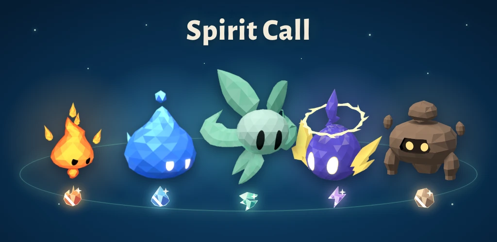
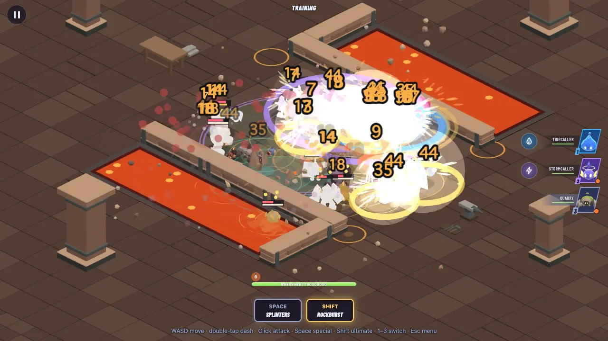
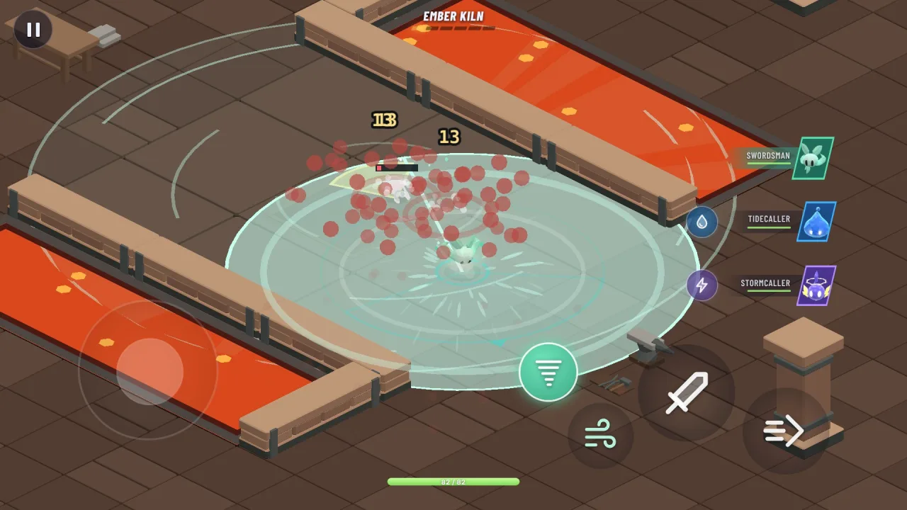
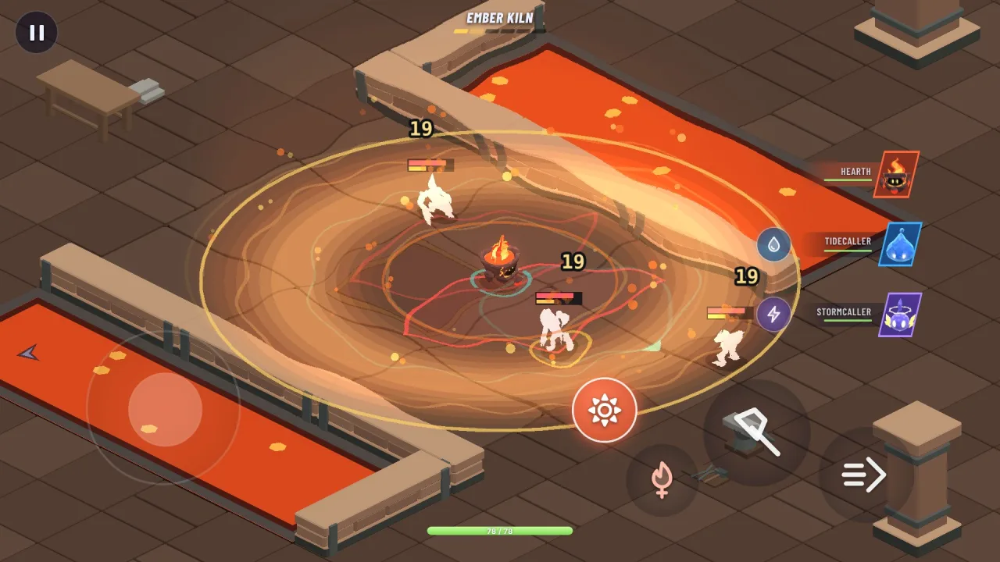
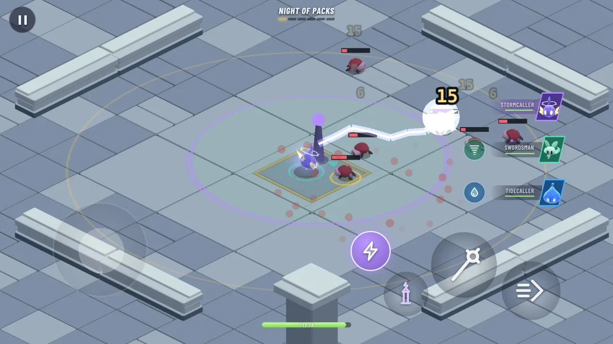
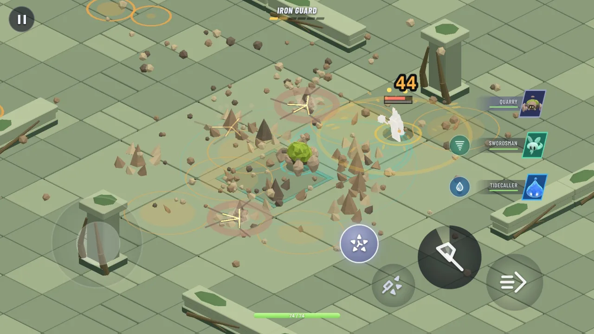
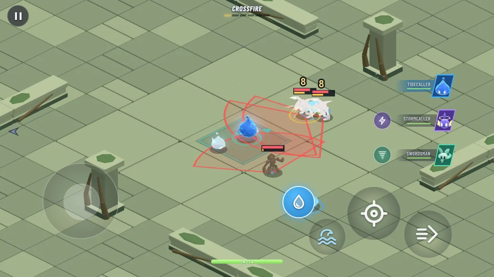
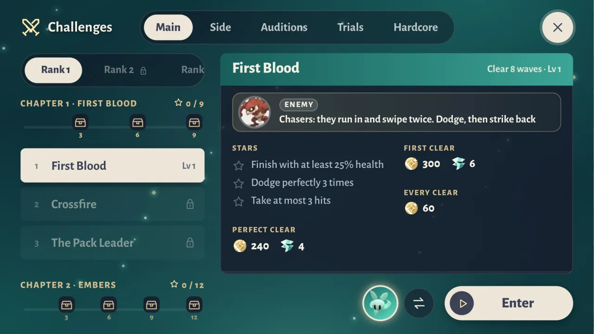
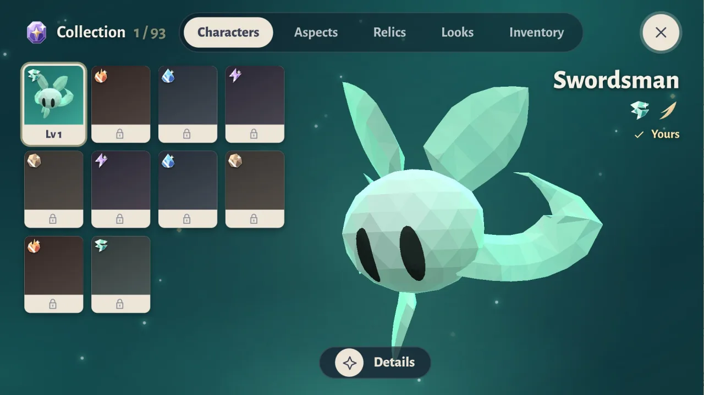
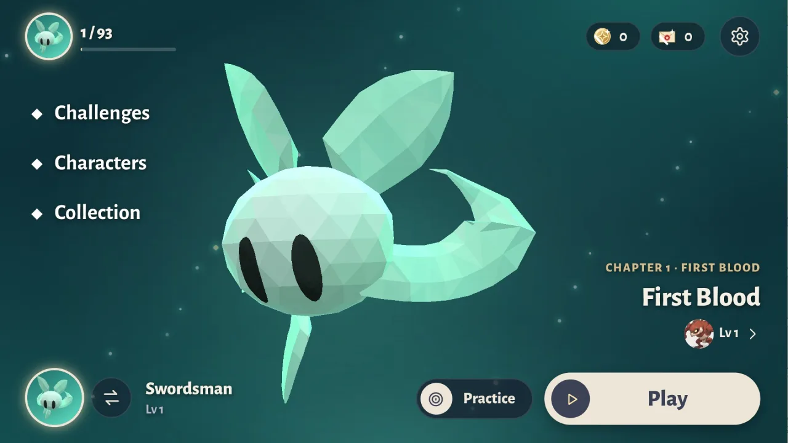

<p align="center"></p>

# Spirit Call

**A top-down action game for the phone, in four-minute fights.** Pick a team
of three elemental spirits, read the enemies you are about to face, and go
in: dodge out of a bad spot, switch to the right spirit, and turn it into a
chain of blows that sets the whole crowd off at once.

<a href="docs/media/spirit-call.mp4">
  <picture>
    <source srcset="docs/media/spirit-call.avif" type="image/avif">
    
  </picture>
</a>

<p align="center"><sub>Water, thunder, and rock taking turns on a crowd. <a href="docs/media/spirit-call.mp4">Watch it in full quality</a>.</sub></p>

<p align="center"><a href="https://spirit-call.typeonce.dev"><b>▶ Play Spirit Call in your browser</b></a> · free, nothing to install, saves stay on your device</p>

Spirit Call is finished, free, and has nothing to buy: every character,
fight, and reward is in the game from the first day, and nothing in it is
random. It runs in the browser, on a computer or a phone, and builds into
Android and iOS apps that play offline. Your save stays on your device.

## Every hit feels good

Combat is the heart of the game. Blows land with hit-stop, recoil, and
knockback, and moves chain into each other: a gust throws the crowd back,
a four-hit combo follows, a dash repositions, a finisher ends it. Dodge at
the last moment and time slows for the enemies while you strike back.

<table>
  <tr>
    <td></td>
    <td></td>
  </tr>
  <tr>
    <td align="center"><sub>the Swordsman's Cyclone draws a crowd in</sub></td>
    <td align="center"><sub>Hearth's Wildfire burns it, and heals the team by what it deals</sub></td>
  </tr>
</table>

Everything is built for a thumb on a phone: a stick on the left, attack,
special, dash, and ultimate on the right, and your team's portraits above
them, one tap to switch. Keyboard and mouse work too.

## Five elements, one rule

Every spirit carries an element (fire, water, wind, thunder, or rock), and
every element follows the same rule. A blow leaves its element's state on
what it hits; a blow of a different element **bursts** it.

| Element | Alone | Burst |
|---|---|---|
| **Fire** | Burning spreads through a dense pack | **Flare**: the burn left, dealt at once, to it and around it |
| **Water** | Soaked enemies hit softer | **Splash**: everything around is disarmed mid-windup |
| **Thunder** | Charged enemies arc your blows onward | **Discharge**: lightning strikes the bodies around it |
| **Wind** | Swept enemies glide, and are stunned against walls | **Gale**: launched, the crowd thrown away, all stunned |
| **Rock** | Cracked enemies break sooner | **Shatter**: a large share of its break bar at once, and a blow around it |

So any two spirits combine. The Stormcaller charges a spread-out group and
every blow arcs between them; bring the Tidecaller and thunder on soaked
enemies splashes the whole group, cutting off what it was winding up.

<table>
  <tr>
    <td></td>
    <td></td>
  </tr>
  <tr>
    <td align="center"><sub>the Stormcaller's totem arcs lightning through a pack</sub></td>
    <td align="center"><sub>Quarry's Rockburst sets off every splinter at once</sub></td>
  </tr>
</table>

## Ten spirits, ten ways to play

Two spirits for each element, and never two who play the same: an
**attacker** fights, a **healer** keeps the team standing, a **guardian**
stops blows before they land. Each one brings a whole kit of its own (a
special, an ultimate, and a body that is bulky or quick, hard-hitting or
frail) and a class that sets its range and rhythm: Blade, Gun, Disc, Staff,
Gauntlets, or Hammer.

The Swordsman is a steady bruiser. The Gunner is a glass cannon who kites.
Sparkfist darts through a line of enemies and turns to lightning. Bastion
raises stone plates that each take one blow whole. Windwall wraps whoever
is fighting in a current that throws back what touches it.

Support is always earned in the fight: a healer heals by what its skills
do there, never by standing on the bench.



## Earn them one at a time

Three spirits come from the main line, which teaches the game a question
at a time: chapter one is dodging and combos alone, chapter two adds
switching, and every quest brings one new thing. The other seven join
through **auditions**: earn an invitation, give it to the spirit you want
next, and win a fight written around that spirit's kit. The order is yours; the
order you choose sets how hard each audition is, never who you can have.

<table>
  <tr>
    <td></td>
    <td></td>
  </tr>
  <tr>
    <td align="center"><sub>every quest shows its enemies and its rewards before you go in</sub></td>
    <td align="center"><sub>the collection, and where each piece comes from</sub></td>
  </tr>
</table>

Each quest has three stars to take, three ranks to climb, and side quests,
trials, and a hardcore post-game of fixed rulesets after it. Gold levels
your spirits and essence ascends them; aspects change how a class fights,
and relics bend a build. About 55 hours to own everything, and about 100
to take all ten spirits to the top.

**Skill is always enough.** There are no damage races: nothing fails you
for being slow, and a skilled player can clear the hardest fights with the
first spirits at a low level.

<p align="center"></p>

## Play

**[Play Spirit Call at spirit-call.typeonce.dev](https://spirit-call.typeonce.dev)**,
on a phone (turn it sideways) or a computer. There is no login: your
accounts and progress are kept by the browser on that device.

Or run it yourself (you need [Node](https://nodejs.org) and
[pnpm](https://pnpm.io)):

```sh
pnpm engine:prepare
pnpm install
pnpm dev
```

Then open the address it prints, on a computer or, with
`pnpm dev --host`, on a phone on the same network.

## How it is made

Spirit Call is written in TypeScript. The fight runs on
[Ritmo](https://github.com/typeonce-dev/ritmo), an ECS where the
simulation is deterministic and headless, so a bot can play every fight of
the game to measure how hard it is. [Three.js](https://threejs.org) draws
the low-poly world, [Preact](https://preactjs.com) the menus,
[Effect](https://effect.website) keeps the save, and
[Capacitor](https://capacitorjs.com) wraps it all into the phone apps.

---

[Developing](DEVELOPMENT.md) · [The vision behind the game](docs/vision.md) · [Elements](docs/elements.md) · [The roster](docs/roster.md)
