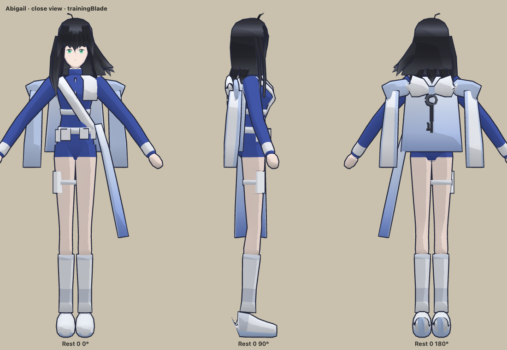

# Abigail: an anime character from a turnaround sheet

A fan study of [Eternal Return's Abigail](https://playeternalreturn.com/posts/news/1337),
made to answer one question before the game's own characters are designed:
**what inputs does an agent need to turn a character sheet into a good
in-game anime character?** It runs the whole pipeline once, from the
official sheet (front, side, back, detail callouts) to a cel-shaded,
rigged, animated model that the game plays as the Swordsman. What the
sheet did not answer is in the guess log below; the resulting
specification for future sheets is [`docs/character-sheet.md`](../../../docs/character-sheet.md).

The sheet is Nimble Neuron's art. `reference/fetch.py` downloads it and
cuts it into views; it is never committed. Nothing else (no mesh, texture,
or animation) comes from the game: everything is built by the scripts here.

## Results



- [Poses](review/poses.png) and [the face](review/face.png), close up, as the game draws them.
- [At arena size on a phone](review/game-size-phone.png), beside the crow (enlarged 2× so pixels show).
- In the live game: [desktop](review/in-game-desktop.png), [combo frames](review/in-game-frames.png), [phone with touch controls](review/in-game-phone.png), and [the menu](review/menu.png).
- Videos: [the moves close up](review/moves-close.mp4) and [at arena size](review/moves-game-size.mp4).

At arena size (20 to 35 CSS pixels tall) she reads as the character: black
bob, royal-blue suit, white sash, pale legs, white boots, and the sword out
from her body during every cut. Close up she is recognizable but plainly a
low-poly, scripted model: blocky hair locks, a simplified cape, plain shoes.
That is the line between what the pipeline reaches alone and what a
character artist's pass would add (see "What a person still adds").

## The model

| | |
| --- | --- |
| Mesh | 4,820 triangles, one material, one 512 px texture (`texture.png`) |
| Skeleton | 28 bones: humanoid body, two-bone limbs, `weapon_grip`, hair (3), cape (3), tail |
| Clips | The crow's ten, with the same lengths and contact frames: `Idle`, `Run`, `RunStart`, `RunStop`, `AttackCombo` (four sections), `Recover1`–`3`, `Power`, `Dash` |
| Proportions | About 6.7 heads: the sheet's 7.2, with the head drawn 10% larger (`HEAD_SCALE`) to read at arena size |
| Shading | Cel-shaded with an outline in the game (`shading: "toon"`, `src/presentation/toon.ts`) |
| Swords | The crow's two, scaled to her hand (`SWORD_SCALE`), held in `weapon_grip` |

## Pipeline

```text
reference/fetch.py   the sheet → front, side, back, face crops (one shared ground line)
paint.py             palette.json → texture.png: flat cells, gradients, the painted face
figure.py, shapes.py measurements → lofted parts, hair locks, outfit; UVs; bone weights
rig.py, motion.py    skeleton, two-bone limbs, choreography, hair and cape springs
build.py             all of the above → abigail.blend
export.py            abigail.glb, swords, model-info.json, verification.json,
                     src/presentation/assets/abigail-timing.ts
render.py, overlay.py  Blender views framed like the sheet's crops, laid over them
inspector/           the model drawn by the game's own code, at fixed clip times
tools/review.sh      review/: inspector stills and videos, the live game, the menu
```

**Measuring.** The sheet's three views stand on one ground line, so a
pixel row is the same height in every view. Her hair top (row 322) to her
soles (row 2400) is 1.62 m; every other height (eyes, chin, shoulders,
waist, crotch, knee, boot) is a row on the sheet. Widths come from the
front view, depths from the side view, and each body part is a loft of
elliptical rings at those heights (`TORSO`, `HEAD`, the leg and arm specs
in `figure.py`). `overlay.py` lays Blender's matching views over the
crops; that comparison drove the proportions.

**Face.** Eyes, brows, lashes, nose, and mouth are painted (`paint.py`) in
a square projected onto the head from the front, measured from the sheet
(eyes 1.47 m high, 54 mm apart). Her face normals lean forward and up, so
the cel shading's edge never crosses her features.

**Motion.** `motion.py` keeps the crow's clip lengths and contact frames,
so the game's combo timing is unchanged (see `docs/models.md`). Poses are
parameters (hip, lean, twist, sword grip and blade direction, free hand,
feet); `rig.py` solves the limbs analytically each frame and bakes plain
bone keys. Her guard holds the blade low and out from her body, where it
reads from the game's camera; the combo is a rising cut, a backhand, a
thrust, and a spinning finisher. Hair, cape, and tail follow with a spring
and drag (they stream behind a run and swing after a cut).

## Rebuild

From the repository root, with Blender 4.5 LTS and `uv`:

```sh
uv run --with pillow art/characters/abigail/reference/fetch.py   # once: the sheet's views
uv run --with pillow art/characters/abigail/paint.py             # after palette or face changes
blender --background --python-exit-code 1 --python art/characters/abigail/build.py
blender --background --python-exit-code 1 --python art/characters/abigail/export.py
```

`build.py` regenerates `abigail.blend`: edits belong in the scripts, not
the Blender file. To compare with the sheet, run `render.py -- sheet`
then `uv run --with pillow art/characters/abigail/overlay.py`
(`renders/overlay.png`). To review in the game, run `pnpm dev --host --port 5207`,
open `/art/characters/abigail/inspector/` (its parameters are at the top of
`inspector/inspector.mjs`), or regenerate everything with
`sh art/characters/abigail/tools/review.sh 5207`.

## Verification

`export.py` fails unless: at most four (in fact two) normalized weights
per vertex; the rest pose stands on the floor; no frame of any clip puts a
vertex more than 2 mm under it; every action ends on its last frame;
under 5,000 triangles, one material, no external files; the skeleton has
`weapon_grip`; and a fresh import of the GLB poses every frame of every
clip within 1 mm of the source (measured: 0.001 mm). `pnpm check` checks
the file has exactly its spec's clips and that the look's moments fit
them (`test/looks.test.ts`), and that outlines smooth hard edges
(`test/toon.test.ts`).

Checked in headless Chrome on the network address: the inspector; the live
game at 1280 × 800 with real mouse and keyboard input (a four-hit combo
that lands, running, a double-tap dash); at 844 × 390 with touch emulation
(the stick, the touch buttons); and the menu's showcase. Not checked on a
physical phone, and not a frame-rate measurement.

## Guess log

What the sheet did not say, what was guessed, and what input would have
settled it. These are the gaps `docs/character-sheet.md` closes.

| The sheet... | So I... | It needed |
| --- | --- | --- |
| Side view leaves out her arms, the cape, the bow, the shoulder panels, and the tail | Guessed their depth and how far they stand from her body | Every view showing everything she wears |
| Front view foreshortens the arms (hands angled toward the viewer); no other view shows them | Used anime-standard arm lengths (upper 0.25 m, forearm 0.22 m) | Arms hanging clear of the body in front and side views |
| Side view draws her feet 10 cm behind her hips (a lean) | Split the difference | A neutral, upright stance in every view |
| Never shows the top of her head, which the game's camera sees most | Shaped the crown and the hair's parting from the front and back | A three-quarter view from above (about 30°) |
| Hair: locks are drawn, not how many, where they start, or which move | Built a cap, a bob shell, and locks (fringe, a long lock on her right, flared ends on her left) by eye | A hair sheet: from above and behind, its locks numbered, which ones move |
| Colors come shaded (gradients, highlights) | Picked flat base colors by eye, guessed the shadow tone | A flat palette with hex values: base and shadow per material |
| Face drawn at 300 px, front and profile only at sheet size | Painted eyes, lashes, brows, and mouth to its measurements | A face sheet: front, three-quarter, profile, the eye drawn large on its own |
| Garment construction: whether the drape, back panel, and tail are one piece, and what is stiff | Made a back panel, a shoulder drape, two shoulder panels with long ends, a hip tail | Notes on how the outfit is built and what flows |
| Weapon is a scythe; no hand pose | Gave her the game's sword, held in a closed fist | Her actual weapon, drawn at scale, in her hand |
| No poses or personality | Invented a low guard and the combo's style | Three or four key poses (stance, a strike), a line on how she moves |
| 7.2 heads tall: fine on a page, small-headed at 30 px | Drew the head 10% larger | A target proportion for the game (or approval to adjust) |
| Many small details (keys, chains, earrings, pouches) | Kept the big ones, dropped the rest | A priority list: what must survive at 30 px |

What the sheet did settle, and settled well: her height and every
landmark (shared ground line), widths and depths of the body, the
silhouette's big shapes, and the color scheme. Those carried the model
most of the way, especially at arena size.

## What a person still adds

- **Hair and face appeal close up.** Scripted locks are blocky; a
  character artist sculpts hair shapes and paints a richer face texture
  (eye highlights, gradients). This shows in the menu, not in the arena.
- **Cloth.** The cape and tail are rigid panels with springs; real cloth
  folds and layered trims need modeling by hand.
- **Animation polish.** Choreography written as numbers is readable and on
  time, but stiff next to keyed or captured motion; the rig takes a
  hand-animated or retargeted pass without changing the game (same clip
  names and contacts).
- **The sheet itself.** The guess log's gaps are cheapest to close at the
  drawing stage.
