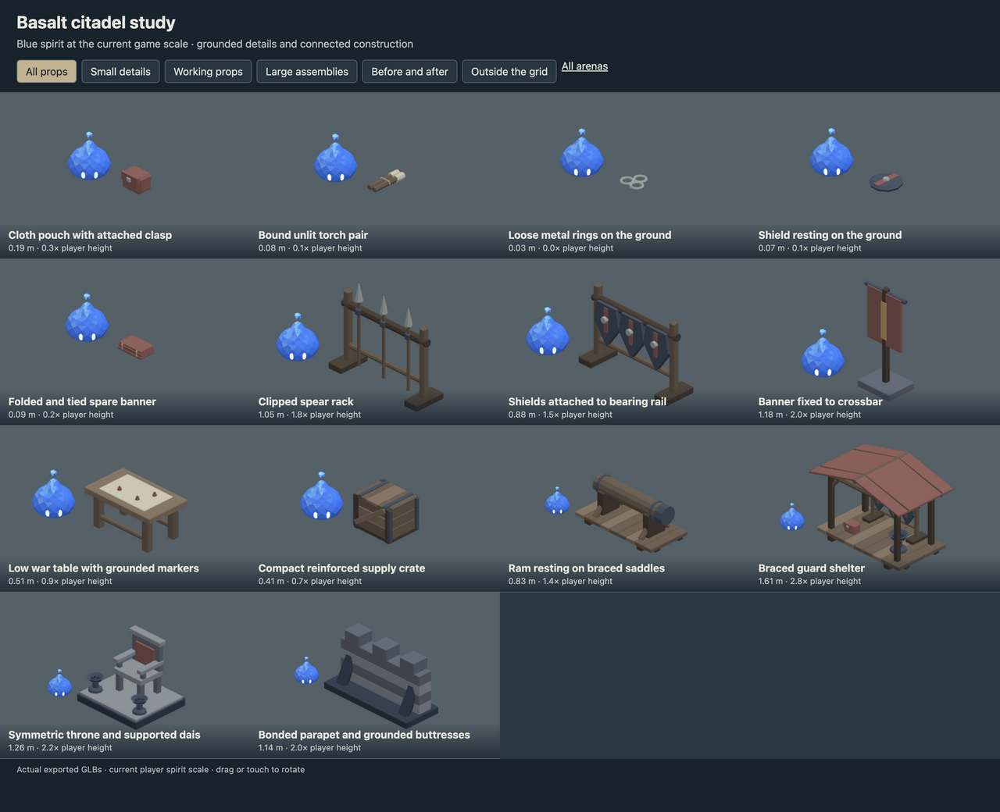
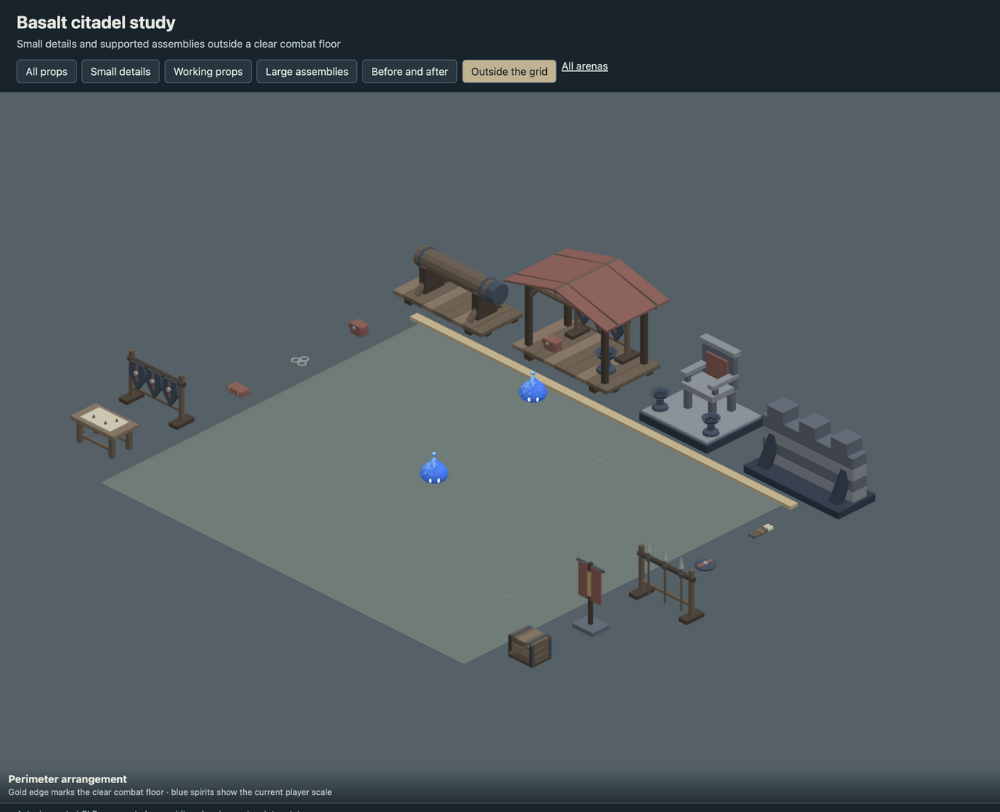
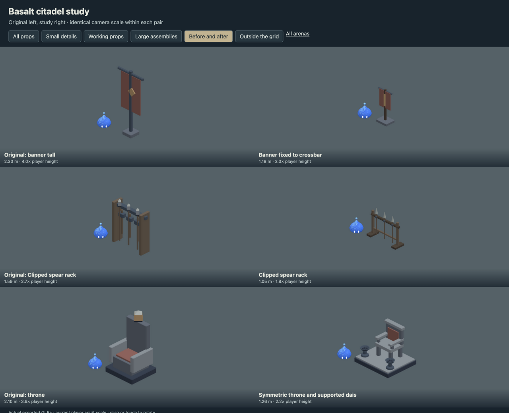

# Basalt citadel study

- Reduced banners, equipment racks and supply crates to practical proportions.
- Added spare equipment, cloth pouches, unlit torches and table markers.
- Rebuilt a symmetric throne; added a supported ram, guard shelter and bonded battlement bay for the perimeter.

This is an art delivery for review, using the current 0.5804 m player spirit.
The playable arena continues to use its existing registered assets. Large scenery
belongs outside the combat floor; the review page checks actual placement bounds.

## Review

Run `pnpm dev --host --port 5200` and open
`/art/environment/basalt-citadel-study/review.html`. Switch between all props,
small details, working props, large assemblies, before/after and exterior views.
Drag or touch to rotate. Each before/after pair uses the same camera scale.





## Models

| Model | Group | Height | Player height ratio | Triangles |
| --- | --- | ---: | ---: | ---: |
| Cloth pouch with attached clasp | small | 0.19 m | 0.3 | 180 |
| Bound unlit torch pair | small | 0.08 m | 0.1 | 244 |
| Loose metal rings on the ground | small | 0.03 m | 0.0 | 360 |
| Shield resting on the ground | small | 0.07 m | 0.1 | 144 |
| Folded and tied spare banner | small | 0.09 m | 0.2 | 360 |
| Clipped spear rack | working | 1.05 m | 1.8 | 620 |
| Shields attached to bearing rail | working | 0.88 m | 1.5 | 608 |
| Banner fixed to crossbar | working | 1.18 m | 2.0 | 268 |
| Low war table with grounded markers | working | 0.51 m | 0.9 | 476 |
| Compact reinforced supply crate | working | 0.41 m | 0.7 | 1680 |
| Ram resting on braced saddles | large | 0.83 m | 1.4 | 1380 |
| Braced guard shelter | large | 1.61 m | 2.8 | 2636 |
| Symmetric throne and supported dais | large | 1.26 m | 2.2 | 1832 |
| Bonded parapet and grounded buttresses | large | 1.14 m | 2.0 | 520 |

## Source and verification

`source/basalt-citadel-study.blend` contains the editable library. `models/` contains
the GLBs, one mesh and one opaque vertex-color material each.
`support-audit.json` records geometric contact through a chain to ground,
with a 2 mm tolerance and zero unsupported pieces. This checks contact,
not structural load capacity. Components touch or intersect within the
joined mesh; they are closed shells rather than one boolean-welded solid.

`verification.json` records the successful manifold-shell, positive-volume,
origin, material, hash and GLB round-trip checks for every model.
Desktop, phone-sized and exterior-bound reviews use the actual exported files.

Rebuild from the repository root. Building requires `--replace-generated`
to replace a generated source. To retain manual Blender edits, export directly.

```sh
/Applications/Blender.app/Contents/MacOS/Blender --background --threads 4 --python-exit-code 1 --python art/environment/basalt-citadel-study/scripts/build.py -- --replace-generated
/Applications/Blender.app/Contents/MacOS/Blender --background --threads 4 --python-exit-code 1 --python art/environment/scripts/export.py -- --kit basalt-citadel-study
/Applications/Blender.app/Contents/MacOS/Blender --background --threads 4 --python-exit-code 1 --python art/environment/scripts/verify.py -- --kit basalt-citadel-study
```

Repository checks use `env VITEST_MAX_WORKERS=2 pnpm check` to avoid
the existing replay-test timeout under default parallelism.
