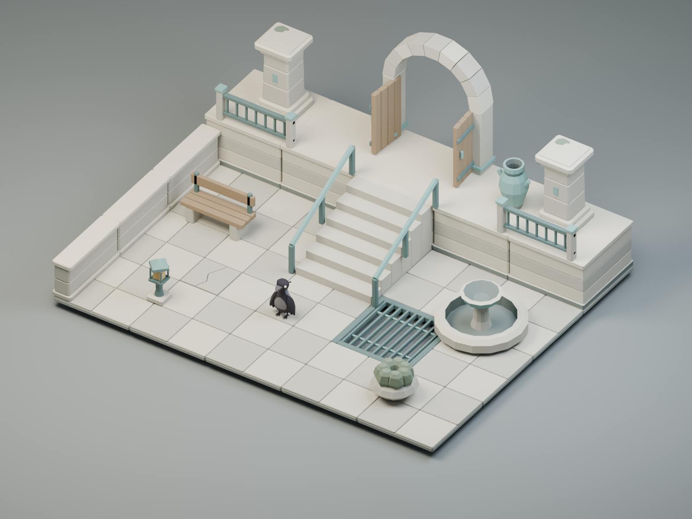

# Courtyard extension

Twenty-five additions preserve the approved warm stone and subdued jade palette. Terraces, hinged doors, grates, railings, paving patterns, and garden furniture extend the original courtyard without editing its eighteen assets.



## View and edit

- [Editable model library](source/courtyard-extension.blend), with one named collection per asset.
- [Editable example scenes](source/examples.blend): terrace, crossing, and enclosure.
- [Labeled contact sheet](previews/contact-sheet.png) and [library top view](previews/top.png).
- [Terrace](previews/terrace.png), [crossing](previews/crossing.png), [enclosure](previews/enclosure.png), and [terrace top view](previews/terrace-top.png).
- [Phone-scale art composition](previews/phone-scale.png), 390 × 844.
- [Door open](previews/doorway-open.png) and [gate open](previews/gate-wide-open.png).
- [Manifest](manifest.json), [layout placements](layouts.json), and [authoring inventory](kit.json).

The optional crow is an external scale reference in the PNGs only. The saved
examples contain environment geometry and studio objects. They are art examples,
not game levels or a test of traversal in the running game.

## Models

25 GLBs, 14,628 triangles total, 1,023,836 bytes combined.
Dimensions are exported X × Y × Z meters. Each model links to its own PNG and GLB.

| Asset and preview | GLB | Dimensions, m | Triangles |
| --- | --- | --- | ---: |
| [bench](previews/bench.png) | [1 mesh](models/bench.glb) | 1.65 × 1.02 × 0.58 | 480 |
| [doorway](previews/doorway.png) | [3 meshes](models/doorway.glb) | 2.69 × 2.982 × 0.58 | 1188 |
| [floor-grate](previews/floor-grate.png) | [1 mesh](models/floor-grate.glb) | 2 × 0.14 × 2 | 900 |
| [fountain-dry](previews/fountain-dry.png) | [1 mesh](models/fountain-dry.glb) | 2.1 × 1.04 × 2.1 | 352 |
| [gate-wide](previews/gate-wide.png) | [3 meshes](models/gate-wide.glb) | 4.69 × 1.96 × 0.58 | 1620 |
| [landing](previews/landing.png) | [1 mesh](models/landing.glb) | 2 × 0.14 × 2 | 300 |
| [lantern](previews/lantern.png) | [1 mesh](models/lantern.glb) | 0.56 × 1.08 × 0.56 | 532 |
| [paving-border-corner](previews/paving-border-corner.png) | [1 mesh](models/paving-border-corner.glb) | 2 × 0.14 × 2 | 120 |
| [paving-cobbles](previews/paving-cobbles.png) | [1 mesh](models/paving-cobbles.glb) | 2 × 0.14 × 2 | 1020 |
| [paving-inset](previews/paving-inset.png) | [1 mesh](models/paving-inset.glb) | 2 × 0.14 × 2 | 600 |
| [paving-large](previews/paving-large.png) | [1 mesh](models/paving-large.glb) | 4 × 0.14 × 2 | 540 |
| [paving-threshold](previews/paving-threshold.png) | [1 mesh](models/paving-threshold.glb) | 2 × 0.14 × 0.6 | 180 |
| [planter](previews/planter.png) | [1 mesh](models/planter.glb) | 1.1 × 0.75 × 1.1 | 692 |
| [platform](previews/platform.png) | [1 mesh](models/platform.glb) | 2 × 1.2 × 2 | 300 |
| [railing-corner](previews/railing-corner.png) | [1 mesh](models/railing-corner.glb) | 2.04 × 0.85 × 2.04 | 1500 |
| [railing-straight](previews/railing-straight.png) | [1 mesh](models/railing-straight.glb) | 2.04 × 0.85 × 0.24 | 780 |
| [stair-full](previews/stair-full.png) | [1 mesh](models/stair-full.glb) | 2 × 1.2 × 2.4 | 720 |
| [stair-rail](previews/stair-rail.png) | [1 mesh](models/stair-rail.glb) | 0.14 × 2.004 × 2.52 | 200 |
| [stair-short](previews/stair-short.png) | [1 mesh](models/stair-short.glb) | 2 × 0.4 × 0.8 | 240 |
| [stair-wide](previews/stair-wide.png) | [1 mesh](models/stair-wide.glb) | 4 × 1.2 × 2.4 | 720 |
| [urn-tall](previews/urn-tall.png) | [1 mesh](models/urn-tall.glb) | 0.876 × 1.15 × 0.68 | 340 |
| [wall-broken](previews/wall-broken.png) | [1 mesh](models/wall-broken.glb) | 2 × 0.88 × 0.5 | 224 |
| [wall-long](previews/wall-long.png) | [1 mesh](models/wall-long.glb) | 4 × 0.95 × 0.5 | 300 |
| [wall-short](previews/wall-short.png) | [1 mesh](models/wall-short.glb) | 1 × 0.95 × 0.5 | 300 |
| [wall-tall](previews/wall-tall.png) | [1 mesh](models/wall-tall.glb) | 2 × 1.8 × 0.5 | 480 |

## Handoff and verification

Read the [shared environment guide](../README.md) for axes, origins, connecting
modules, moving parts, collision, walk surfaces, references, and regeneration.
IDs are scoped to this folder; use `courtyard-extension/<asset-id>` as a library key.
They are not shipped account-content IDs.

The library has no textures, required glTF extensions, animation clips, lights,
or cameras in its GLBs. Moving doors retain their mesh hierarchy and local pivots.
The manifest describes how to open them; it does not implement interactions.

[Blender verification](verification.json) passed source geometry and fresh-import
checks for every asset, including opening the exported door leaves and checking
passage clearance. [Khronos validation](gltf-validation.json) reports zero errors
and warnings for all 25 exports. Hashes bind these reports to the supplied files.

```sh
python3 art/environment/scripts/run.py --kit courtyard-extension --render --crow art/characters/crow/crow.glb
```

This exports the saved source and regenerates the previews. Add `--build` only
to create a source from `kit.json`. Replacing an existing source additionally
requires `--replace-generated` and discards manual edits.

## Selected references

- [Reference 1](https://braverobynart.com/deathsdoor)
- [Reference 2](https://folsen.artstation.com/projects/ZeVlBN)
- [Reference 3](https://blog.playstation.com/2024/01/19/genshin-impact-version-4-4-brings-new-friends-and-visual-enhancements-jan-31/)
