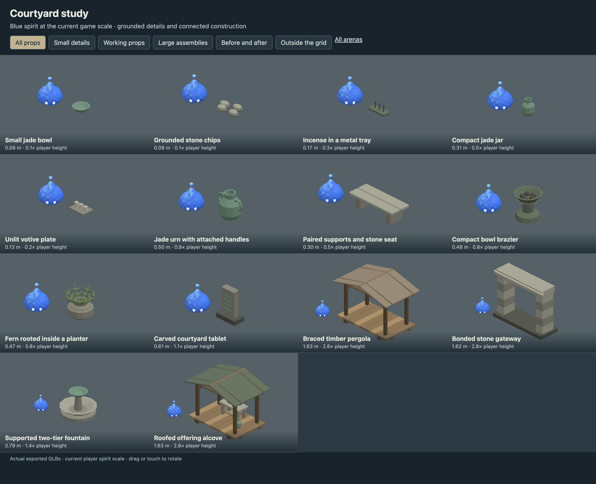
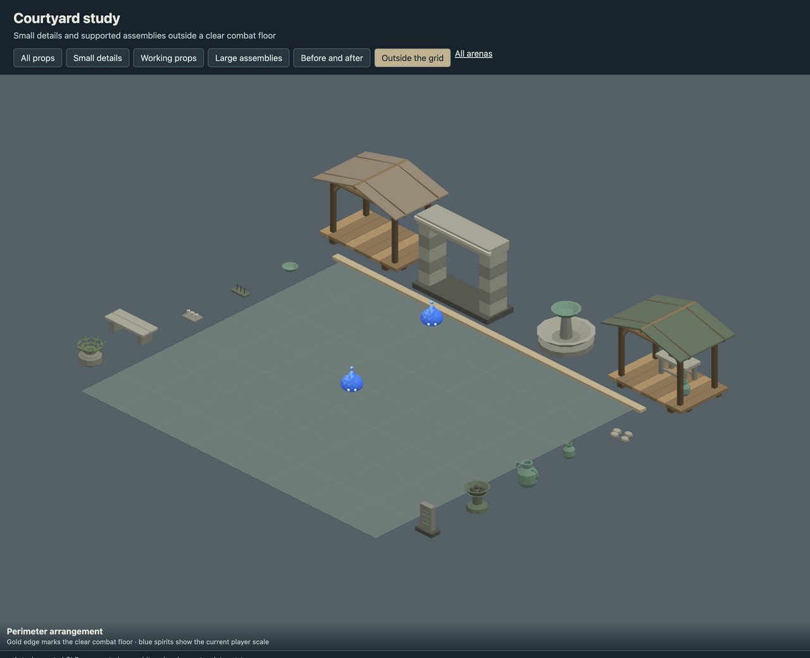
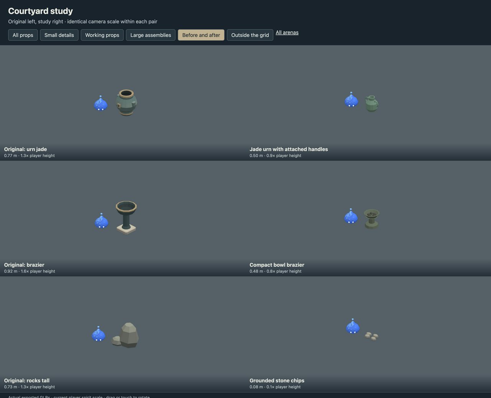

# Courtyard study

- Reduced jade urn and brazier proportions beside the current spirit.
- Added small ritual details, a low bench and rooted planter.
- Added supported pergola, gateway, fountain and offering alcove for the perimeter.

These models are now placed in the playable arena, using the current 0.5804 m player spirit.
Small ground details are decorative; solid props use simulation collisions.
Large assemblies stand outside the arena walls on extended paving.
See [in-game layouts and previews](../studies/IN_GAME.md).

## Review

Run `pnpm dev --host --port 5200` and open
`/art/environment/courtyard-study/review.html`. Switch between all props,
small details, working props, large assemblies, before/after and exterior views.
Drag or touch to rotate. Each before/after pair uses the same camera scale.





## Models

| Model | Group | Height | Player height ratio | Triangles |
| --- | --- | ---: | ---: | ---: |
| Small jade bowl | small | 0.08 m | 0.1 | 140 |
| Grounded stone chips | small | 0.08 m | 0.1 | 208 |
| Incense in a metal tray | small | 0.17 m | 0.3 | 108 |
| Compact jade jar | small | 0.31 m | 0.5 | 284 |
| Unlit votive plate | small | 0.13 m | 0.2 | 192 |
| Jade urn with attached handles | working | 0.50 m | 0.9 | 572 |
| Paired supports and stone seat | working | 0.30 m | 0.5 | 240 |
| Compact bowl brazier | working | 0.48 m | 0.8 | 496 |
| Fern rooted inside a planter | working | 0.47 m | 0.8 | 1220 |
| Carved courtyard tablet | working | 0.61 m | 1.1 | 360 |
| Braced timber pergola | large | 1.63 m | 2.8 | 1352 |
| Bonded stone gateway | large | 1.62 m | 2.8 | 780 |
| Supported two-tier fountain | large | 0.79 m | 1.4 | 416 |
| Roofed offering alcove | large | 1.63 m | 2.8 | 2100 |

## Source and verification

`source/courtyard-study.blend` contains the editable library. `models/` contains
the GLBs, one mesh and one opaque vertex-color material each.
`support-audit.json` records geometric contact through a chain to ground,
with a 2 mm tolerance and zero unsupported pieces. This checks contact,
not structural load capacity. Components touch or intersect within the
joined mesh; they are closed shells rather than one boolean-welded solid.

`verification.json` records the successful manifold-shell, positive-volume,
origin, material, hash and GLB round-trip checks for every model.
Desktop, phone-sized and exterior-bound reviews use the actual exported files.

Rebuild from the repository root. Building requires `--replace-generated`
to replace a generated source. To retain manual Blender edits, export directly.

```sh
/Applications/Blender.app/Contents/MacOS/Blender --background --threads 4 --python-exit-code 1 --python art/environment/courtyard-study/scripts/build.py -- --replace-generated
/Applications/Blender.app/Contents/MacOS/Blender --background --threads 4 --python-exit-code 1 --python art/environment/scripts/export.py -- --kit courtyard-study
/Applications/Blender.app/Contents/MacOS/Blender --background --threads 4 --python-exit-code 1 --python art/environment/scripts/verify.py -- --kit courtyard-study
```

Repository checks use `env VITEST_MAX_WORKERS=2 pnpm check` to avoid
the existing replay-test timeout under default parallelism.
