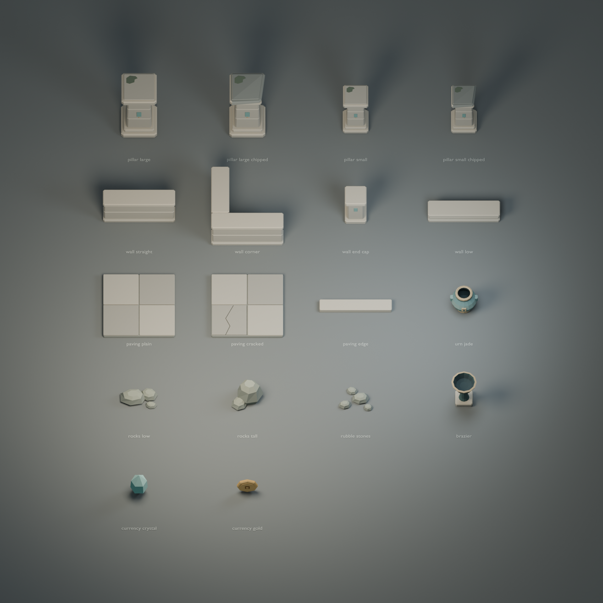

# Courtyard asset kit

Eighteen low-poly Blender models and portable GLB exports, built around the
reviewed stone pillar, paving module, and jade urn. No game code or dependencies
are changed. The kit can merge independently of the Three.js migration.



## View and edit

Open [source/courtyard.blend](source/courtyard.blend) in Blender 4.5 LTS.
The eighteen named meshes are editable, with vertex colors in the `Color`
attribute. The saved scene includes an inspection camera and lights; F12
renders the lineup. The `STUDIO` collection is only for viewing.

The PNGs require no viewer installation:

- [Courtyard composition](previews/courtyard-overview.png), with repeated paving,
  boundary walls, both pillar sizes, props, and the crow as a scale reference.
- [Top view](previews/top.png), useful for footprints and the urn opening.
- Every model has an individual PNG in `previews/`, named after its asset ID.
  Examples: [pillar](previews/pillar-large.png), [corner wall](previews/wall-corner.png),
  [urn](previews/urn-jade.png), [brazier](previews/brazier.png),
  [crystal](previews/currency-crystal.png), [gold token](previews/currency-gold.png).
- [Small-scale view](previews/phone-scale.png), rendered at 390 × 844.

The composition uses a 0.95 m tall crow as a proposed proportion reference.
This is not a decision about its final game scale. The crow was read from
the existing static `crow.glb`, leaving local Blender edits untouched, and is absent from all supplied
Blender sources and GLBs. Its source hash is recorded in
`previews/render-info.json`. Reproducing that optional comparison requires
the same external source; the asset pack itself is self-contained.

The small-scale image uses a 30-degree elevation as a reference to the old
sprite camera. It is an art check, not a screenshot of the Three.js migration,
a touch test, or a phone performance measurement.

## Runtime assets

| ID | Dimensions, X × Y × Z in exported meters | Triangles | Use |
|---|---|---:|---|
| `pillar-large`, `pillar-large-chipped` | 1 × 1.899 × 1 | 748 each | Solid obstacle; square 1 × 1 footprint |
| `pillar-small`, `pillar-small-chipped` | 0.714 × 1.481 × 0.714 | 748 each | Current arena's 50:70 footprint ratio |
| `wall-straight` | 2 × 0.95 × 0.5 | 240 | Boundary segment along X |
| `wall-corner` | 2 × 0.95 × 2 | 480 | L-shaped boundary; two footprint boxes |
| `wall-end-cap` | 0.6 × 1.07 × 0.6 | 240 | Boundary terminator |
| `wall-low` | 2 × 0.38 × 0.5 | 240 | Lower foreground boundary visual |
| `paving-plain` | 2 × 0.14 × 2 | 300 | Ground decoration; 2 m placement grid |
| `paving-cracked` | 2 × 0.14 × 2 | 280 | Matching module with a split stone |
| `paving-edge` | 2 × 0.14 × 0.35 | 60 | Border strip along X |
| `rocks-low` | 1.038 × 0.3 × 0.639 | 156 | Three broad low rocks |
| `rocks-tall` | 0.893 × 0.73 × 0.787 | 104 | Tall rock with smaller companion |
| `rubble-stones` | 0.944 × 0.2 × 0.777 | 208 | Four small scattered stones |
| `urn-jade` | 0.769 × 0.775 × 0.719 | 844 | Edge decoration; no gameplay collision |
| `brazier` | 0.7 × 0.92 × 0.7 | 340 | Bowl and stand; flame socket in manifest |
| `currency-crystal` | 0.48 × 0.86 × 0.416 | 44 | Opaque faceted reward visual |
| `currency-gold` | 0.58 × 0.58 × 0.124 | 208 | Upright octagonal reward token |

The eighteen GLBs total 467,364 bytes, about 456 KiB, and 6,736 triangles.
Each has one mesh and one opaque material
primitive. They use flat normals and vertex colors, with no textures,
animations, lights, cameras, or required extensions. No Draco decoder is
needed. Material roughness is 0.87. Each file carries its own material, so the
renderer may deduplicate that shared material after loading.

`manifest.json` is the machine-readable handoff. Bounds, triangle counts,
byte sizes, and SHA-256 hashes are generated from the actual exports.
Dimensions use X/Y/Z order; footprint values use X/Z order.

### Placement and collision

- Blender uses Z up and -Y forward. GLB exports use +Y up and +Z forward.
- All exported roots have identity transforms. Library display positions in
  the Blender file are discarded on export; mesh-local dimensions are kept.
- Props, pillars, walls, and currency origins are at ground center. The urn's
  emblem and gold token's decorated face point +Z.
- Paving has its origin at **top center**, so its walking surface is Y=0 and
  its thickness extends downward. Place adjacent modules 2 m apart. Bevels
  leave a narrow seam; the four slabs inside a module have 2 cm joints.
- The pillar's maximum X/Z extent is its 1 m square base. Its shaft is
  narrower; the game should continue using the existing square collision
  footprint rather than deriving collision from the decorative mesh.
- Chipped and intact pillar variants share the same base. The small base is
  exactly 5/7 of the large base. Heights are art proportions, separately tunable
  during integration.
- Wall runs extend along X. Straight and low walls share a 2 × 0.5 footprint.
  The corner is the union of two boxes, recorded with centers in X/Z. Do not
  replace its L shape with a solid 2 × 2 box. Rotate the mesh and footprint
  descriptions together if mapping them to gameplay geometry.
- The brazier's `sockets.flame.position_m` is `[0, 0.84, 0]`. It contains no
  animated flame, emissive effect, or light. Those belong to presentation.
- Currency meshes are visual representations, with no implied pickup or drop
  behavior. The crystal uses opaque colors, so it needs no transparency sorting.
- `collision: null` means this asset does not define gameplay collision.
  The urn is intended for edges, not as an invisible obstruction in a lane.
- The manifest is a delivery description, not a new simulation/content API.
  These IDs are not account-save IDs and are not added to `test/content-ids.json`.

## Handoff to the Three.js migration

The `environment-assets` branch is based on shared main commit `7ca149d`.
Its only tracked additions are in this directory. Either the migration or
the assets can merge first. No crow/renderer file needs a conflict resolution
for this kit.

After both land, the integrating change should bundle `models/*.glb` through
the game's asset pipeline. These repository paths are not assumed to be
public URLs in a production build. Use `manifest.json` for dimensions and
choose the conversion between exported meters and game units in presentation.

For example, if the current 70-unit pillar is retained, a uniform scale of
70 game units per exported meter fits this model's base. That would also make
its height about 133 game units, so height needs visual review; footprint
compatibility does not imply the old 64-unit visual height is preserved.
The renderer can choose a different presentation height independently of the
unchanged collision box. The small pillar already uses the 50:70 footprint
ratio. Metadata describes compatible geometry; it does not authorize changes
to arena placement or simulation rules.

Keep obstacle fading and ground-effect visibility in the renderer. Inspect
the models under its actual camera and lighting before calling integration
finished. No custom renderer or visualizer is included here.

## Rebuild and verify

Run from the repository root. Blender supplies Python; no Python packages
or Blender add-ons are required.

```sh
BLENDER=/Applications/Blender.app/Contents/MacOS/Blender

# Export the saved source, including intentional manual edits.
"$BLENDER" --background --python-exit-code 1 --python art/environment/courtyard/scripts/export.py
"$BLENDER" --background --python-exit-code 1 --python art/environment/courtyard/scripts/verify.py

# Render asset-only inspection views from the saved source.
"$BLENDER" --background --python-exit-code 1 --python art/environment/courtyard/scripts/render.py

# Optionally include the external crow study in composition images.
"$BLENDER" --background --python-exit-code 1 --python art/environment/courtyard/scripts/render.py -- --crow /absolute/path/to/crow.glb
```

`build.py` creates the authored kit from parameters. It refuses to overwrite
an existing source unless passed `-- --replace-generated`. That option replaces
manual model edits, so only use it to deliberately regenerate the source.
`export.py`, `verify.py`, and `render.py` do not save changes to the source.
Apply edited object rotation, scale, and modifiers before exporting. Keep the
`asset_id`, `purpose`, `footprint_m`, and `origin_note` custom properties accurate,
along with any `collision_json` or `sockets_json` metadata.

For a single preview, add `-- --asset wall-corner` to `render.py`.
`-- --composition-only --crow /absolute/path/to/crow.glb` rebuilds only the
courtyard and small-scale composition. Ordinary rendering rebuilds every view.

The geometric verifier checks finite coordinates, closed manifold component
shells, nonzero faces, overall outward volume, GLB axes and origins, vertex
colors, material count, no external resources, and fresh-import bounds and
triangle counts. The deliberately separate stone courses and decorative
parts can intersect; this is a game mesh, not a watertight manufacturing solid.

Khronos glTF Validator can run outside the game dependency tree:

```sh
npm install --prefix /tmp/courtyard-gltf-validation --no-package-lock --ignore-scripts gltf-validator@2.0.0-dev.3.10
node art/environment/courtyard/scripts/validate-gltf.cjs /tmp/courtyard-gltf-validation/node_modules/gltf-validator
```

`verification.json` records the Blender checks. `gltf-validation.json` records
the Khronos results with the GLB hashes. The delivered kit passed with zero
errors, warnings, infos, or hints for all eighteen models. Repository `pnpm check`
also passed: typecheck, lint, and 225 tests. Runtime integration is still pending.

## Art direction

Warm grey stone, subdued jade ceramics, small bronze accents, broad bevels,
and a quiet floor. Intact and chipped pillars have matching collision footprints.
Moss stays on the cap, clear of the walking surface. Floor cracks are gaps
between closed pieces, not raised polygons that could flicker against the floor.

Shape and composition references: Frits Olsen's
[Death's Door environment concepts](https://folsen.artstation.com/projects/ZeVlBN),
particularly Flooded Fortress and Mushroom Dungeon. Palette reference:
[HoYoverse's Chenyu Vale overview](https://blog.playstation.com/2024/01/19/genshin-impact-version-4-4-brings-new-friends-and-visual-enhancements-jan-31/).
The meshes and palette here were authored in Blender for this project. No
reference-game geometry or texture is included.

The sample's proportions and palette were reviewed before expanding the kit.
Destructibility, drops, and shrine interactions are outside this art task.
