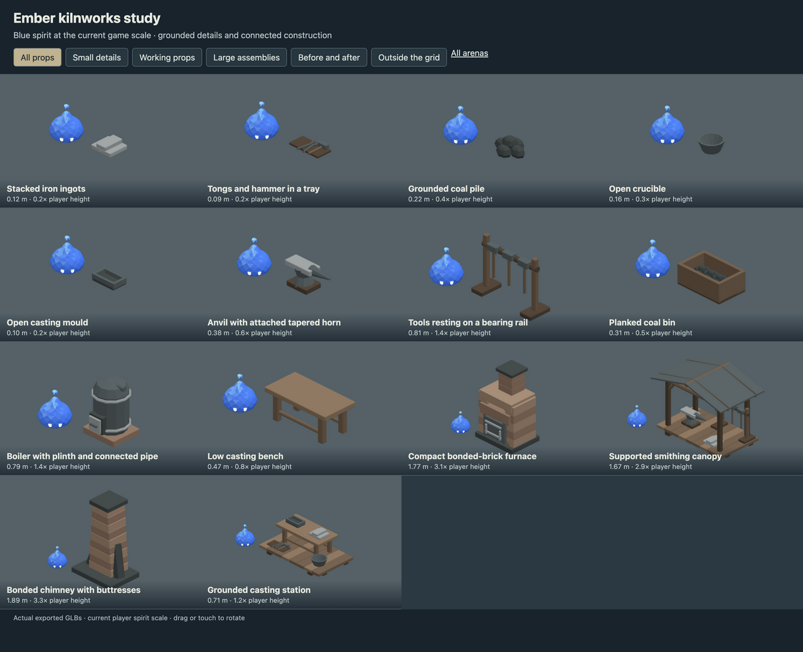
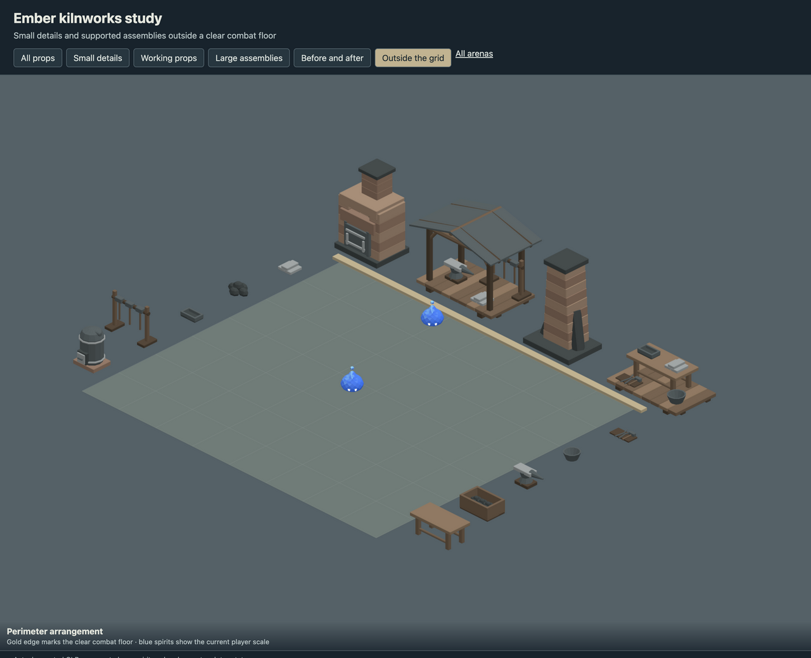
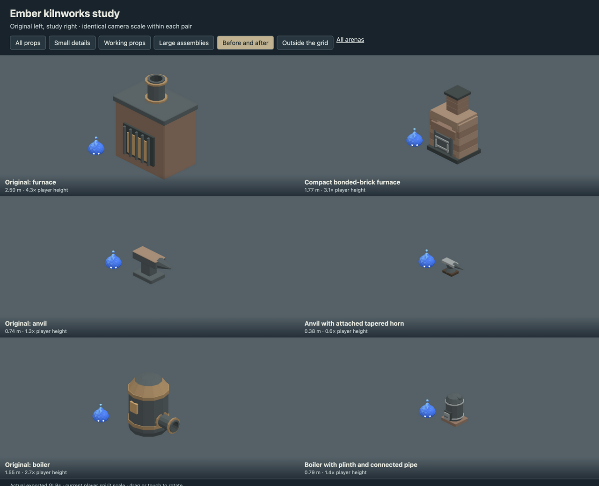

# Ember kilnworks study

- Reduced the furnace, boiler, anvil and tool proportions beside the spirit.
- Added ingots, tongs, coal, open crucibles and casting moulds.
- Rebuilt furnace piers and chimney supports; added smithing and casting bays outside the grid.

These models are now placed in the playable arena, using the current 0.5804 m player spirit.
Small ground details are decorative; solid props use simulation collisions.
Large assemblies stand outside the arena walls on extended paving.
See [in-game layouts and previews](../studies/IN_GAME.md).

## Review

Run `pnpm dev --host --port 5200` and open
`/art/environment/ember-kilnworks-study/review.html`. Switch between all props,
small details, working props, large assemblies, before/after and exterior views.
Drag or touch to rotate. Each before/after pair uses the same camera scale.





## Models

| Model | Group | Height | Player height ratio | Triangles |
| --- | --- | ---: | ---: | ---: |
| Stacked iron ingots | small | 0.12 m | 0.2 | 180 |
| Tongs and hammer in a tray | small | 0.09 m | 0.2 | 228 |
| Grounded coal pile | small | 0.22 m | 0.4 | 260 |
| Open crucible | small | 0.16 m | 0.3 | 140 |
| Open casting mould | small | 0.10 m | 0.2 | 300 |
| Anvil with attached tapered horn | working | 0.38 m | 0.6 | 192 |
| Tools resting on a bearing rail | working | 0.81 m | 1.4 | 532 |
| Planked coal bin | working | 0.31 m | 0.5 | 1132 |
| Boiler with plinth and connected pipe | working | 0.79 m | 1.4 | 640 |
| Low casting bench | working | 0.47 m | 0.8 | 356 |
| Compact bonded-brick furnace | large | 1.77 m | 3.1 | 1560 |
| Supported smithing canopy | large | 1.67 m | 2.9 | 2256 |
| Bonded chimney with buttresses | large | 1.89 m | 3.3 | 700 |
| Grounded casting station | large | 0.71 m | 1.2 | 1924 |

## Source and verification

`source/ember-kilnworks-study.blend` contains the editable library. `models/` contains
the GLBs, one mesh and one opaque vertex-color material each.
`support-audit.json` records geometric contact through a chain to ground,
with a 2 mm tolerance and zero unsupported pieces. This checks contact,
not structural load capacity. Components touch or intersect within the
joined mesh; they are closed shells rather than one boolean-welded solid.

`verification.json` records the successful manifold-shell, positive-volume,
origin, material, hash and GLB round-trip checks for every model.
Desktop, phone-sized and exterior-bound reviews use the actual exported files.

Rebuild from the repository root. Building requires `--replace-generated`
to replace a generated source. To retain manual Blender edits, export directly.

```sh
/Applications/Blender.app/Contents/MacOS/Blender --background --threads 4 --python-exit-code 1 --python art/environment/ember-kilnworks-study/scripts/build.py -- --replace-generated
/Applications/Blender.app/Contents/MacOS/Blender --background --threads 4 --python-exit-code 1 --python art/environment/scripts/export.py -- --kit ember-kilnworks-study
/Applications/Blender.app/Contents/MacOS/Blender --background --threads 4 --python-exit-code 1 --python art/environment/scripts/verify.py -- --kit ember-kilnworks-study
```

Repository checks use `env VITEST_MAX_WORKERS=2 pnpm check` to avoid
the existing replay-test timeout under default parallelism.
