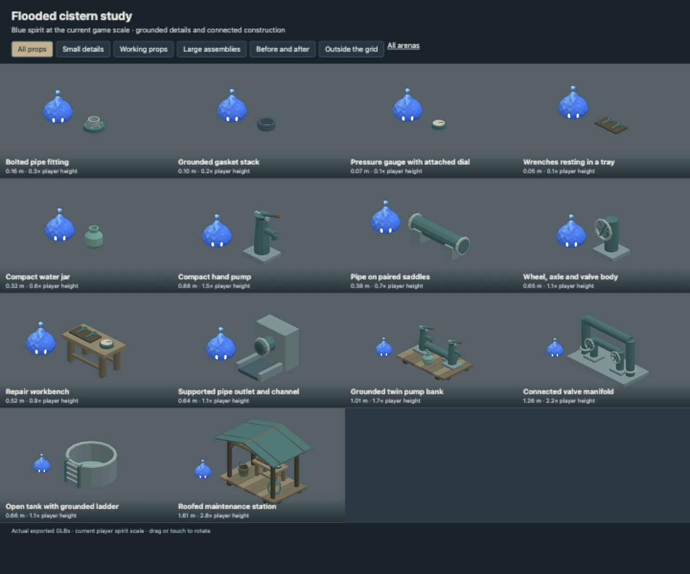
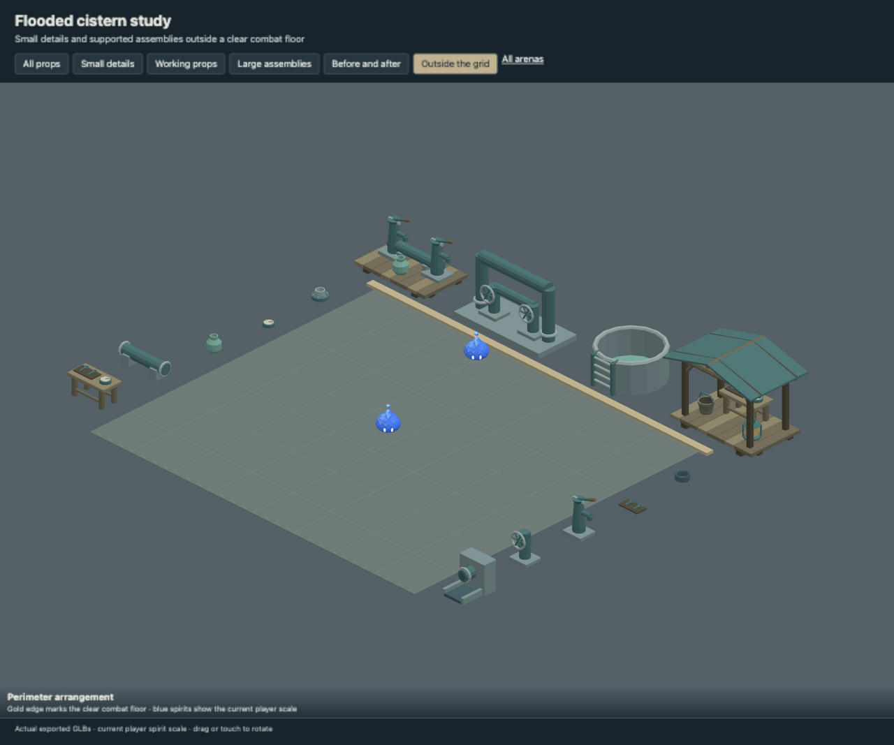
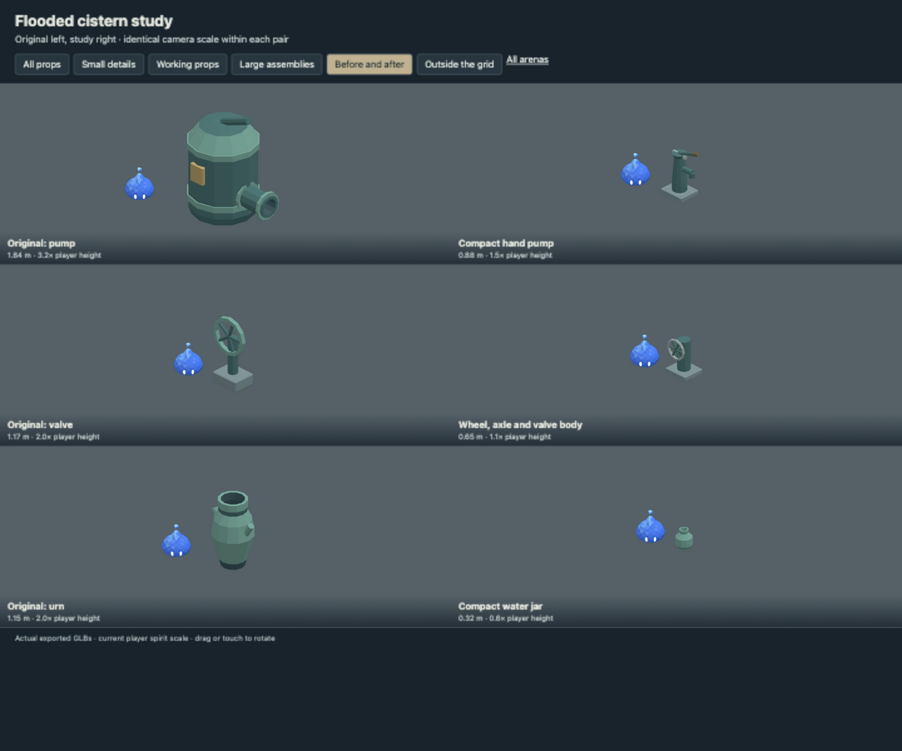

# Flooded cistern study

- Rebuilt pump handles, wheel spokes and pipe supports at everyday prop scale.
- Added repair fittings, gaskets, dial gauges, tools and water jars.
- Added connected pump bank, manifold, settling tank and roofed service station outside the grid.

This is an art delivery for review, using the current 0.5804 m player spirit.
The playable arena continues to use its existing registered assets. Large scenery
belongs outside the combat floor; the review page checks actual placement bounds.

## Review

Run `pnpm dev --host --port 5200` and open
`/art/environment/flooded-cistern-study/review.html`. Switch between all props,
small details, working props, large assemblies, before/after and exterior views.
Drag or touch to rotate. Each before/after pair uses the same camera scale.





## Models

| Model | Group | Height | Player height ratio | Triangles |
| --- | --- | ---: | ---: | ---: |
| Bolted pipe fitting | small | 0.16 m | 0.3 | 284 |
| Grounded gasket stack | small | 0.10 m | 0.2 | 432 |
| Pressure gauge with attached dial | small | 0.07 m | 0.1 | 240 |
| Wrenches resting in a tray | small | 0.05 m | 0.1 | 292 |
| Compact water jar | small | 0.32 m | 0.6 | 284 |
| Compact hand pump | working | 0.88 m | 1.5 | 316 |
| Pipe on paired saddles | working | 0.38 m | 0.7 | 452 |
| Wheel, axle and valve body | working | 0.65 m | 1.1 | 352 |
| Repair workbench | working | 0.52 m | 0.9 | 888 |
| Supported pipe outlet and channel | working | 0.64 m | 1.1 | 472 |
| Grounded twin pump bank | large | 1.01 m | 1.7 | 1800 |
| Connected valve manifold | large | 1.26 m | 2.2 | 1220 |
| Open tank with grounded ladder | large | 0.66 m | 1.1 | 728 |
| Roofed maintenance station | large | 1.61 m | 2.8 | 3204 |

## Source and verification

`source/flooded-cistern-study.blend` contains the editable library. `models/` contains
the GLBs, one mesh and one opaque vertex-color material each.
`support-audit.json` records geometric contact through a chain to ground,
with a 2 mm tolerance and zero unsupported pieces. This checks contact,
not structural load capacity. Components touch or intersect within the
joined mesh; they are closed shells rather than one boolean-welded solid.

`verification.json` records the successful manifold-shell, positive-volume,
origin, material, hash and GLB round-trip checks for every model.
Desktop, phone-sized and exterior-bound reviews use the actual exported files.

Rebuild from the repository root. Building requires `--replace-generated`
to replace a generated source. To retain manual Blender edits, export directly.

```sh
/Applications/Blender.app/Contents/MacOS/Blender --background --threads 4 --python-exit-code 1 --python art/environment/flooded-cistern-study/scripts/build.py -- --replace-generated
/Applications/Blender.app/Contents/MacOS/Blender --background --threads 4 --python-exit-code 1 --python art/environment/scripts/export.py -- --kit flooded-cistern-study
/Applications/Blender.app/Contents/MacOS/Blender --background --threads 4 --python-exit-code 1 --python art/environment/scripts/verify.py -- --kit flooded-cistern-study
```

Repository checks use `env VITEST_MAX_WORKERS=2 pnpm check` to avoid
the existing replay-test timeout under default parallelism.
