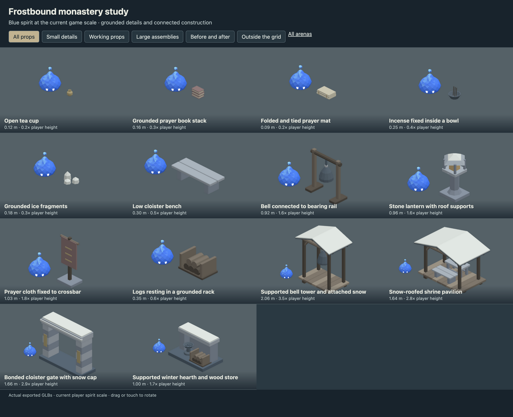
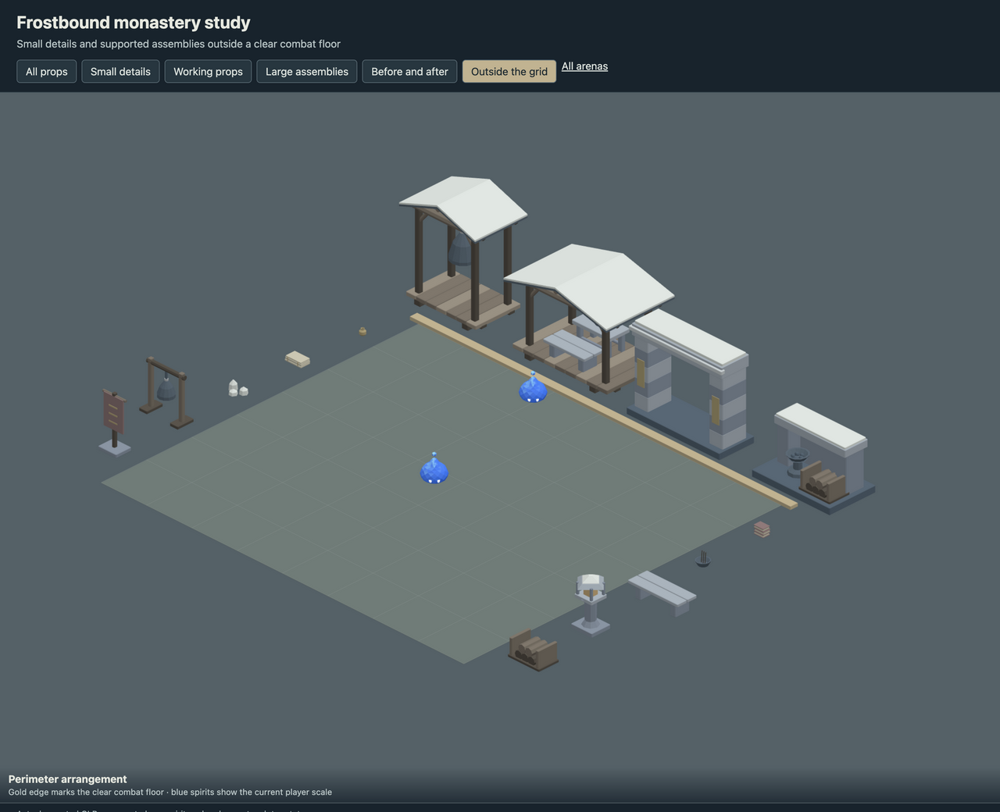
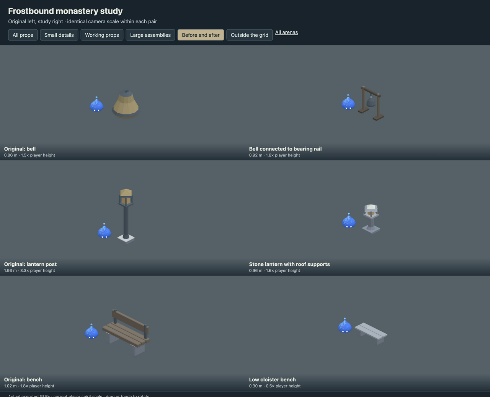

# Frostbound monastery study

- Reduced benches, lanterns and banners; connected every bell to a visible hanger and bearing rail.
- Added tea cups, prayer books, folded mats, planted incense, grounded ice and stacked firewood.
- Added a snow-roofed bell tower, shrine pavilion, bonded cloister gate and winter hearth outside the grid.

This is an art delivery for review, using the current 0.5804 m player spirit.
The playable arena continues to use its existing registered assets. Large scenery
belongs outside the combat floor; the review page checks actual placement bounds.

## Review

Run `pnpm dev --host --port 5200` and open
`/art/environment/frostbound-monastery-study/review.html`. Switch between all props,
small details, working props, large assemblies, before/after and exterior views.
Drag or touch to rotate. Each before/after pair uses the same camera scale.





## Models

| Model | Group | Height | Player height ratio | Triangles |
| --- | --- | ---: | ---: | ---: |
| Open tea cup | small | 0.12 m | 0.2 | 284 |
| Grounded prayer book stack | small | 0.16 m | 0.3 | 540 |
| Folded and tied prayer mat | small | 0.09 m | 0.2 | 360 |
| Incense fixed inside a bowl | small | 0.25 m | 0.4 | 188 |
| Grounded ice fragments | small | 0.18 m | 0.3 | 96 |
| Low cloister bench | working | 0.30 m | 0.5 | 240 |
| Bell connected to bearing rail | working | 0.92 m | 1.6 | 580 |
| Stone lantern with roof supports | working | 0.96 m | 1.6 | 520 |
| Prayer cloth fixed to crossbar | working | 1.03 m | 1.8 | 388 |
| Logs resting in a grounded rack | working | 0.35 m | 0.6 | 320 |
| Supported bell tower and attached snow | large | 2.06 m | 3.5 | 1596 |
| Snow-roofed shrine pavilion | large | 1.64 m | 2.8 | 2160 |
| Bonded cloister gate with snow cap | large | 1.66 m | 2.9 | 960 |
| Supported winter hearth and wood store | large | 1.00 m | 1.7 | 1176 |

## Source and verification

`source/frostbound-monastery-study.blend` contains the editable library. `models/` contains
the GLBs, one mesh and one opaque vertex-color material each.
`support-audit.json` records geometric contact through a chain to ground,
with a 2 mm tolerance and zero unsupported pieces. This checks contact,
not structural load capacity. Components touch or intersect within the
joined mesh; they are closed shells rather than one boolean-welded solid.

`verification.json` records the successful manifold-shell, positive-volume,
origin, material, hash and GLB round-trip checks for every model.
Desktop, phone-sized and exterior-bound reviews use the actual exported files.

Rebuild from the repository root. Building requires `--replace-generated`
to replace a generated source. To retain manual Blender edits, export directly.

```sh
/Applications/Blender.app/Contents/MacOS/Blender --background --threads 4 --python-exit-code 1 --python art/environment/frostbound-monastery-study/scripts/build.py -- --replace-generated
/Applications/Blender.app/Contents/MacOS/Blender --background --threads 4 --python-exit-code 1 --python art/environment/scripts/export.py -- --kit frostbound-monastery-study
/Applications/Blender.app/Contents/MacOS/Blender --background --threads 4 --python-exit-code 1 --python art/environment/scripts/verify.py -- --kit frostbound-monastery-study
```

Repository checks use `env VITEST_MAX_WORKERS=2 pnpm check` to avoid
the existing replay-test timeout under default parallelism.
