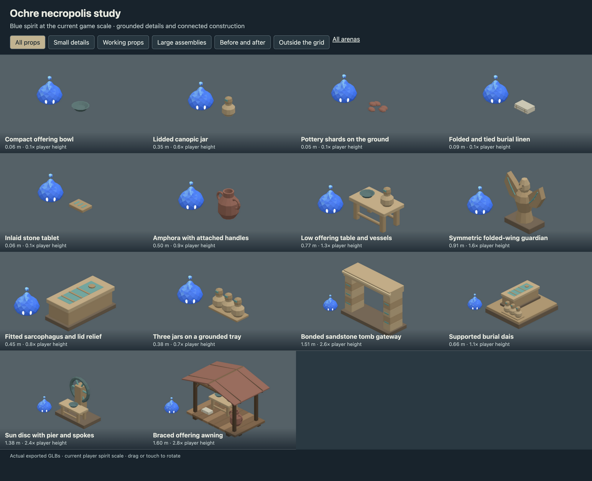
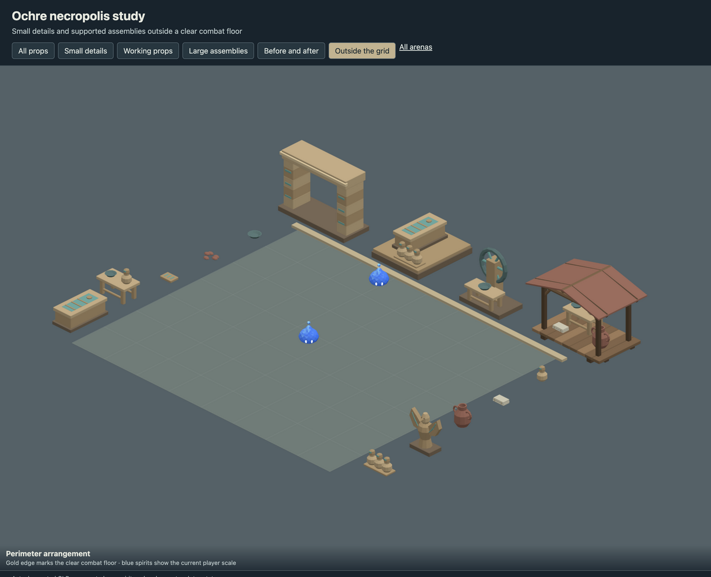
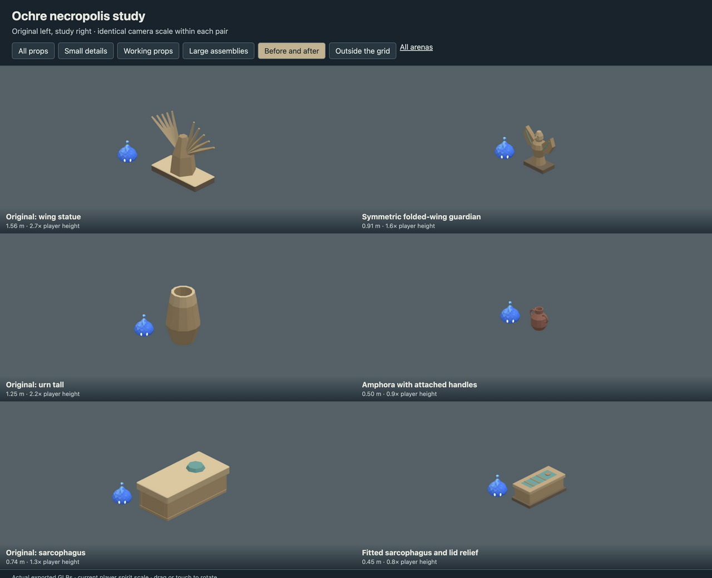

# Ochre necropolis study

- Reduced urn, offering-table and burial-goods proportions; fitted the sarcophagus lid.
- Rebuilt the guardian with mirrored folded wings, attached feather relief and a carved face.
- Added small ritual details, a bonded tomb gateway, burial dais, supported sun altar and offering awning.

This is an art delivery for review, using the current 0.5804 m player spirit.
The playable arena continues to use its existing registered assets. Large scenery
belongs outside the combat floor; the review page checks actual placement bounds.

## Review

Run `pnpm dev --host --port 5200` and open
`/art/environment/ochre-necropolis-study/review.html`. Switch between all props,
small details, working props, large assemblies, before/after and exterior views.
Drag or touch to rotate. Each before/after pair uses the same camera scale.





## Models

| Model | Group | Height | Player height ratio | Triangles |
| --- | --- | ---: | ---: | ---: |
| Compact offering bowl | small | 0.06 m | 0.1 | 140 |
| Lidded canopic jar | small | 0.35 m | 0.6 | 404 |
| Pottery shards on the ground | small | 0.05 m | 0.1 | 260 |
| Folded and tied burial linen | small | 0.09 m | 0.1 | 360 |
| Inlaid stone tablet | small | 0.06 m | 0.1 | 240 |
| Amphora with attached handles | working | 0.50 m | 0.9 | 572 |
| Low offering table and vessels | working | 0.77 m | 1.3 | 900 |
| Symmetric folded-wing guardian | working | 0.91 m | 1.6 | 492 |
| Fitted sarcophagus and lid relief | working | 0.45 m | 0.8 | 448 |
| Three jars on a grounded tray | working | 0.38 m | 0.7 | 1272 |
| Bonded sandstone tomb gateway | large | 1.51 m | 2.6 | 1200 |
| Supported burial dais | large | 0.66 m | 1.1 | 1840 |
| Sun disc with pier and spokes | large | 1.38 m | 2.4 | 868 |
| Braced offering awning | large | 1.60 m | 2.8 | 3184 |

## Source and verification

`source/ochre-necropolis-study.blend` contains the editable library. `models/` contains
the GLBs, one mesh and one opaque vertex-color material each.
`support-audit.json` records geometric contact through a chain to ground,
with a 2 mm tolerance and zero unsupported pieces. This checks contact,
not structural load capacity. Components touch or intersect within the
joined mesh; they are closed shells rather than one boolean-welded solid.

`verification.json` records the successful manifold-shell, positive-volume,
origin, material, hash and GLB round-trip checks for every model.
Desktop, phone-sized and exterior-bound reviews use the actual exported files.

Rebuild from the repository root. Building requires `--replace-generated`
to replace a generated source. To retain manual Blender edits, export directly.

```sh
/Applications/Blender.app/Contents/MacOS/Blender --background --threads 4 --python-exit-code 1 --python art/environment/ochre-necropolis-study/scripts/build.py -- --replace-generated
/Applications/Blender.app/Contents/MacOS/Blender --background --threads 4 --python-exit-code 1 --python art/environment/scripts/export.py -- --kit ochre-necropolis-study
/Applications/Blender.app/Contents/MacOS/Blender --background --threads 4 --python-exit-code 1 --python art/environment/scripts/verify.py -- --kit ochre-necropolis-study
```

Repository checks use `env VITEST_MAX_WORKERS=2 pnpm check` to avoid
the existing replay-test timeout under default parallelism.
