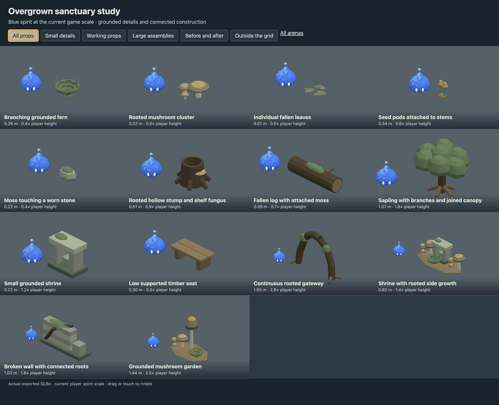
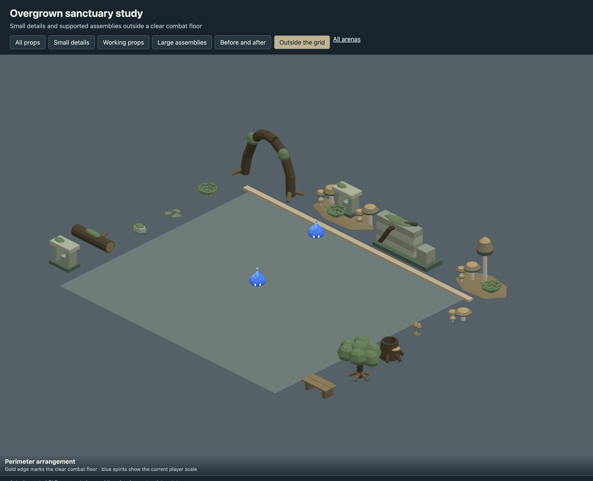
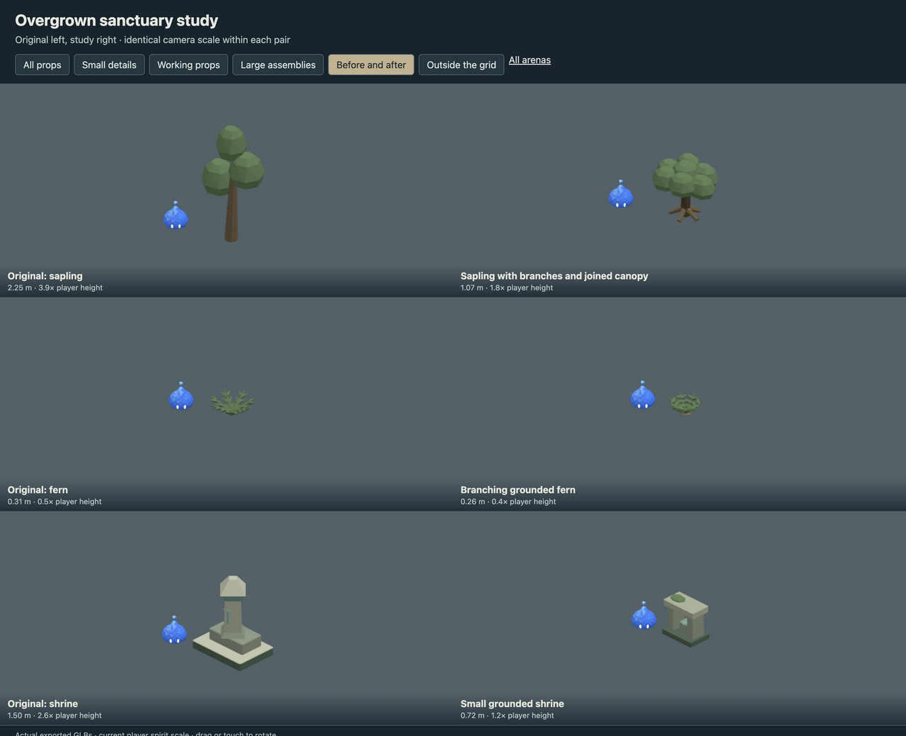

# Overgrown sanctuary study

- Replaced coarse plant silhouettes with connected stems, fronds, roots and branch-supported canopies.
- Reduced shrine and stump sizes; added leaf litter, seed pods, moss stones and low seating.
- Added a continuous root gateway, shrine grove, rooted ruin and mushroom garden around the perimeter.

This is an art delivery for review, using the current 0.5804 m player spirit.
The playable arena continues to use its existing registered assets. Large scenery
belongs outside the combat floor; the review page checks actual placement bounds.

## Review

Run `pnpm dev --host --port 5200` and open
`/art/environment/overgrown-sanctuary-study/review.html`. Switch between all props,
small details, working props, large assemblies, before/after and exterior views.
Drag or touch to rotate. Each before/after pair uses the same camera scale.





## Models

| Model | Group | Height | Player height ratio | Triangles |
| --- | --- | ---: | ---: | ---: |
| Branching grounded fern | small | 0.26 m | 0.4 | 892 |
| Rooted mushroom cluster | small | 0.32 m | 0.5 | 384 |
| Individual fallen leaves | small | 0.01 m | 0.0 | 308 |
| Seed pods attached to stems | small | 0.34 m | 0.6 | 188 |
| Moss touching a worn stone | small | 0.22 m | 0.4 | 104 |
| Rooted hollow stump and shelf fungus | working | 0.51 m | 0.9 | 340 |
| Fallen log with attached moss | working | 0.39 m | 0.7 | 208 |
| Sapling with branches and joined canopy | working | 1.07 m | 1.8 | 700 |
| Small grounded shrine | working | 0.72 m | 1.2 | 404 |
| Low supported timber seat | working | 0.30 m | 0.5 | 240 |
| Continuous rooted gateway | large | 1.65 m | 2.8 | 456 |
| Shrine with rooted side growth | large | 0.82 m | 1.4 | 2116 |
| Broken wall with connected roots | large | 1.03 m | 1.8 | 508 |
| Grounded mushroom garden | large | 1.44 m | 2.5 | 1456 |

## Source and verification

`source/overgrown-sanctuary-study.blend` contains the editable library. `models/` contains
the GLBs, one mesh and one opaque vertex-color material each.
`support-audit.json` records geometric contact through a chain to ground,
with a 2 mm tolerance and zero unsupported pieces. This checks contact,
not structural load capacity. Components touch or intersect within the
joined mesh; they are closed shells rather than one boolean-welded solid.

`verification.json` records the successful manifold-shell, positive-volume,
origin, material, hash and GLB round-trip checks for every model.
Desktop, phone-sized and exterior-bound reviews use the actual exported files.

Rebuild from the repository root. Building requires `--replace-generated`
to replace a generated source. To retain manual Blender edits, export directly.

```sh
/Applications/Blender.app/Contents/MacOS/Blender --background --threads 4 --python-exit-code 1 --python art/environment/overgrown-sanctuary-study/scripts/build.py -- --replace-generated
/Applications/Blender.app/Contents/MacOS/Blender --background --threads 4 --python-exit-code 1 --python art/environment/scripts/export.py -- --kit overgrown-sanctuary-study
/Applications/Blender.app/Contents/MacOS/Blender --background --threads 4 --python-exit-code 1 --python art/environment/scripts/verify.py -- --kit overgrown-sanctuary-study
```

Repository checks use `env VITEST_MAX_WORKERS=2 pnpm check` to avoid
the existing replay-test timeout under default parallelism.
