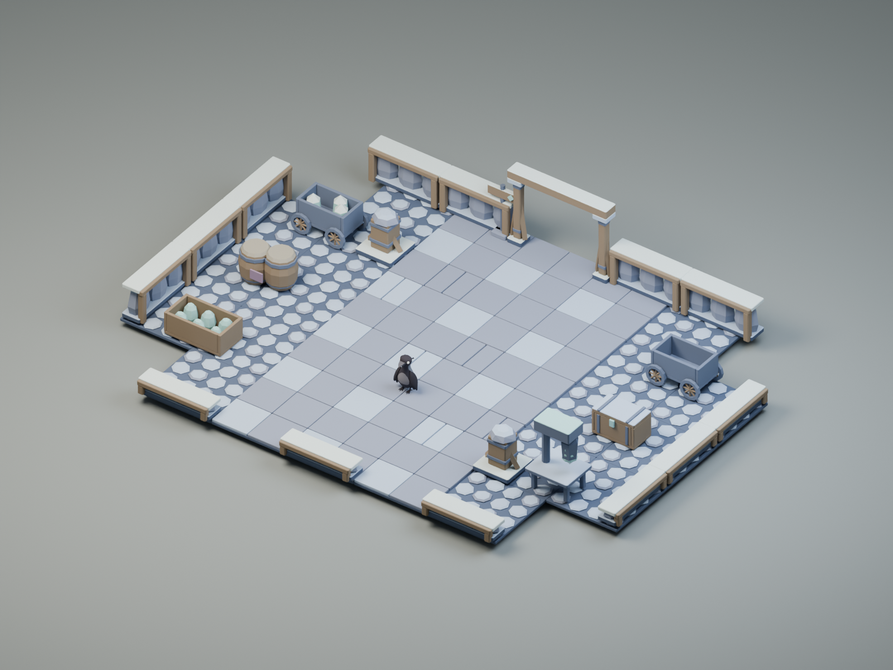

# Prism quarry

Faceted slate, pale mineral seams and timber shoring. Excavation yards and galleries mix broad fighting floors with rail-side work areas.



## Review and edit

- [Labeled contact sheet](previews/contact-sheet.png), [library top view](previews/top.png), and [phone-scale review](previews/phone-scale.png).
- [Editable model library](source/prism-quarry.blend) and [four editable assemblies](source/examples.blend).
- [Manifest](manifest.json), [layout placements and reserved areas](layouts.json), and [full authoring inventory](kit.json).
- [Door open](previews/doorway-open.png), [gate open](previews/gate-wide-open.png), [open cache](previews/supply-cache-open.png), and [active beacon](previews/beacon-active.png).

| Intended use | Assembly | Plan |
| --- | --- | --- |
| quest skirmish | [excavation-yard](previews/excavation-yard.png) | [Top view](previews/excavation-yard-top.png) |
| dungeon connector | [haulage-crossing](previews/haulage-crossing.png) | [Top view](previews/haulage-crossing-top.png) |
| boss or elite room | [crystal-gallery](previews/crystal-gallery.png) | [Top view](previews/crystal-gallery-top.png) |
| survival arena | [winch-terrace](previews/winch-terrace.png) | [Top view](previews/winch-terrace-top.png) |

The assemblies propose spaces for future quests and dungeon rooms. They are
editable art scenes, not shipped gameplay levels. The crow is a read-only size
reference in PNGs and is excluded from the saved assemblies and model exports.
Tall props belong at boundaries; review occlusion under the actual game camera.

## Models

70 GLBs, 37,292 triangles combined, 2,631,920 bytes combined.
These totals describe the library, not one arena's draw cost. Every static asset
has one mesh and one opaque vertex-color material. Each hinged door has a frame
and two leaves. No textures, required glTF extensions, or animation clips.

| Model preview | Export | Dimensions in XYZ meters | Triangles |
| --- | --- | --- | ---: |
| [arch-free](previews/arch-free.png) | [GLB](models/arch-free.glb) | 2.902 × 2.07 × 0.4 | 708 |
| [beacon-active](previews/beacon-active.png) | [GLB](models/beacon-active.glb) | 1 × 1.67 × 1 | 232 |
| [beacon-idle](previews/beacon-idle.png) | [GLB](models/beacon-idle.glb) | 1 × 1.12 × 1 | 104 |
| [bridge](previews/bridge.png) | [GLB](models/bridge.glb) | 2 × 0.3 × 4 | 1080 |
| [bridge-wide](previews/bridge-wide.png) | [GLB](models/bridge-wide.glb) | 4 × 0.3 × 4 | 1080 |
| [cart-empty](previews/cart-empty.png) | [GLB](models/cart-empty.glb) | 1.5 × 0.87 × 1 | 876 |
| [cave-rock-large](previews/cave-rock-large.png) | [GLB](models/cave-rock-large.glb) | 2.486 × 1.9 × 1.3 | 52 |
| [cave-rock-small](previews/cave-rock-small.png) | [GLB](models/cave-rock-small.glb) | 1.052 × 0.75 × 1.3 | 52 |
| [crystal-cluster](previews/crystal-cluster.png) | [GLB](models/crystal-cluster.glb) | 1.497 × 1.5 × 0.882 | 184 |
| [crystal-large](previews/crystal-large.png) | [GLB](models/crystal-large.glb) | 0.9 × 2.1 × 0.779 | 44 |
| [crystal-small](previews/crystal-small.png) | [GLB](models/crystal-small.glb) | 0.46 × 0.7 × 0.398 | 44 |
| [doorway](previews/doorway.png) | [GLB](models/doorway.glb) | 2.717 × 1.96 × 0.5 | 1548 |
| [drill-rig](previews/drill-rig.png) | [GLB](models/drill-rig.glb) | 1.2 × 1.9 × 1 | 624 |
| [floor-border](previews/floor-border.png) | [GLB](models/floor-border.glb) | 2 × 0.14 × 0.3 | 180 |
| [floor-border-corner](previews/floor-border-corner.png) | [GLB](models/floor-border-corner.glb) | 2 × 0.14 × 2 | 120 |
| [floor-cracked](previews/floor-cracked.png) | [GLB](models/floor-cracked.glb) | 2 × 0.14 × 2 | 420 |
| [floor-deck](previews/floor-deck.png) | [GLB](models/floor-deck.glb) | 2 × 0.3 × 2 | 600 |
| [floor-grate](previews/floor-grate.png) | [GLB](models/floor-grate.glb) | 2 × 0.14 × 2 | 900 |
| [floor-inset](previews/floor-inset.png) | [GLB](models/floor-inset.glb) | 2 × 0.14 × 2 | 600 |
| [floor-large](previews/floor-large.png) | [GLB](models/floor-large.glb) | 4 × 0.14 × 2 | 540 |
| [floor-plain](previews/floor-plain.png) | [GLB](models/floor-plain.glb) | 2 × 0.14 × 2 | 300 |
| [floor-radial](previews/floor-radial.png) | [GLB](models/floor-radial.glb) | 2 × 0.14 × 2 | 436 |
| [floor-rubble](previews/floor-rubble.png) | [GLB](models/floor-rubble.glb) | 2 × 0.14 × 2 | 892 |
| [floor-small](previews/floor-small.png) | [GLB](models/floor-small.glb) | 1 × 0.14 × 1 | 120 |
| [floor-threshold](previews/floor-threshold.png) | [GLB](models/floor-threshold.glb) | 2 × 0.14 × 0.6 | 180 |
| [floor-transition](previews/floor-transition.png) | [GLB](models/floor-transition.glb) | 2 × 0.14 × 2 | 300 |
| [floor-worn](previews/floor-worn.png) | [GLB](models/floor-worn.glb) | 2 × 0.14 × 2 | 1020 |
| [gate-wide](previews/gate-wide.png) | [GLB](models/gate-wide.glb) | 4.69 × 1.96 × 0.58 | 1620 |
| [landing](previews/landing.png) | [GLB](models/landing.glb) | 2 × 0.14 × 2 | 300 |
| [lift-cage](previews/lift-cage.png) | [GLB](models/lift-cage.glb) | 1.5 × 2.15 × 1.5 | 960 |
| [mine-cart](previews/mine-cart.png) | [GLB](models/mine-cart.glb) | 1.5 × 1 × 1 | 1008 |
| [mine-lamp](previews/mine-lamp.png) | [GLB](models/mine-lamp.glb) | 0.4 × 1.165 × 0.4 | 276 |
| [ore-bin](previews/ore-bin.png) | [GLB](models/ore-bin.glb) | 1.6 × 0.6 × 0.9 | 612 |
| [ore-vein](previews/ore-vein.png) | [GLB](models/ore-vein.glb) | 1.497 × 0.915 × 0.882 | 184 |
| [pickaxe-rack](previews/pickaxe-rack.png) | [GLB](models/pickaxe-rack.glb) | 1.4 × 1.45 × 0.4 | 524 |
| [pillar-broken](previews/pillar-broken.png) | [GLB](models/pillar-broken.glb) | 1 × 1.08 × 1 | 316 |
| [pillar-large](previews/pillar-large.png) | [GLB](models/pillar-large.glb) | 1.011 × 1.9 × 1 | 324 |
| [pillar-small](previews/pillar-small.png) | [GLB](models/pillar-small.glb) | 0.77 × 1.45 × 0.72 | 324 |
| [platform](previews/platform.png) | [GLB](models/platform.glb) | 2.014 × 1.2 × 2.08 | 456 |
| [platform-edge](previews/platform-edge.png) | [GLB](models/platform-edge.glb) | 2.014 × 1.2 × 0.33 | 456 |
| [platform-wide](previews/platform-wide.png) | [GLB](models/platform-wide.glb) | 4 × 1.2 × 2.08 | 612 |
| [powder-kegs](previews/powder-kegs.png) | [GLB](models/powder-kegs.glb) | 1.42 × 0.91 × 0.98 | 468 |
| [railing-corner](previews/railing-corner.png) | [GLB](models/railing-corner.glb) | 2.04 × 0.85 × 2.04 | 1500 |
| [railing-straight](previews/railing-straight.png) | [GLB](models/railing-straight.glb) | 2.04 × 0.85 × 0.24 | 780 |
| [seal-plinth](previews/seal-plinth.png) | [GLB](models/seal-plinth.glb) | 1.2 × 0.77 × 1.2 | 168 |
| [stair-full](previews/stair-full.png) | [GLB](models/stair-full.glb) | 2 × 1.2 × 2.4 | 720 |
| [stair-narrow](previews/stair-narrow.png) | [GLB](models/stair-narrow.glb) | 1 × 1.2 × 2.4 | 720 |
| [stair-rail](previews/stair-rail.png) | [GLB](models/stair-rail.glb) | 0.14 × 2.004 × 2.52 | 200 |
| [stair-short](previews/stair-short.png) | [GLB](models/stair-short.glb) | 2 × 0.4 × 0.8 | 240 |
| [stair-wide](previews/stair-wide.png) | [GLB](models/stair-wide.glb) | 4 × 1.2 × 2.4 | 720 |
| [stalagmites](previews/stalagmites.png) | [GLB](models/stalagmites.glb) | 1.306 × 1.8 × 0.918 | 156 |
| [supply-cache](previews/supply-cache.png) | [GLB](models/supply-cache.glb) | 1.2 × 0.73 × 0.765 | 660 |
| [supply-cache-open](previews/supply-cache-open.png) | [GLB](models/supply-cache-open.glb) | 1.2 × 1.32 × 0.846 | 1092 |
| [support-broken](previews/support-broken.png) | [GLB](models/support-broken.glb) | 2.055 × 1.735 × 0.3 | 180 |
| [timber-shoring](previews/timber-shoring.png) | [GLB](models/timber-shoring.glb) | 2.1 × 2.12 × 0.3 | 204 |
| [track-corner](previews/track-corner.png) | [GLB](models/track-corner.glb) | 1.55 × 0.185 × 1.55 | 216 |
| [track-straight](previews/track-straight.png) | [GLB](models/track-straight.glb) | 1.15 × 0.17 × 2 | 360 |
| [wall-broken](previews/wall-broken.png) | [GLB](models/wall-broken.glb) | 2.014 × 0.79 × 0.58 | 500 |
| [wall-buttress](previews/wall-buttress.png) | [GLB](models/wall-buttress.glb) | 2.014 × 1.8 × 1.15 | 488 |
| [wall-corner](previews/wall-corner.png) | [GLB](models/wall-corner.glb) | 2.014 × 0.95 × 2.094 | 860 |
| [wall-end](previews/wall-end.png) | [GLB](models/wall-end.glb) | 0.606 × 1.05 × 0.58 | 404 |
| [wall-grille](previews/wall-grille.png) | [GLB](models/wall-grille.glb) | 1.5 × 1.2 × 0.14 | 720 |
| [wall-long](previews/wall-long.png) | [GLB](models/wall-long.glb) | 4 × 0.95 × 0.58 | 612 |
| [wall-low](previews/wall-low.png) | [GLB](models/wall-low.glb) | 2.014 × 0.38 × 0.58 | 456 |
| [wall-short](previews/wall-short.png) | [GLB](models/wall-short.glb) | 1.009 × 0.95 × 0.58 | 404 |
| [wall-straight](previews/wall-straight.png) | [GLB](models/wall-straight.glb) | 2.014 × 0.95 × 0.58 | 456 |
| [wall-tall](previews/wall-tall.png) | [GLB](models/wall-tall.glb) | 2.014 × 1.8 × 0.58 | 456 |
| [wall-window](previews/wall-window.png) | [GLB](models/wall-window.glb) | 2.014 × 2.3 × 0.58 | 1504 |
| [waymarker](previews/waymarker.png) | [GLB](models/waymarker.glb) | 0.8 × 1.4 × 0.4 | 208 |
| [winch](previews/winch.png) | [GLB](models/winch.glb) | 1.1 × 1.23 × 0.86 | 632 |

## Handoff

Read the [beta arena plan](../BETA-ARENAS.md) for role coverage and reference
choices, and the [shared guide](../README.md) for origins, axes and runtime
integration. Use `prism-quarry/<asset-id>` as the library key. These are art IDs,
not persistent gameplay-content IDs.

Floors connect on the 2 m grid at Y=0. The narrow stair is 1 m wide; full and
wide flights are 2 m and 4 m wide, all rising 1.2 m over 2.4 m. The wide bridge
is 4 × 4 m; the wide platform is 4 × 2 m and rises 1.2 m. Walk planes, stair
ramps, static collision suggestions and door pivots are in the manifest.
Cache and beacon states are separate static assets for presentation to swap.
They define no interaction, reward, elemental effect or gameplay timer.

[Source and import checks](verification.json), [Khronos validation](gltf-validation.json),
and [delivery audit](delivery-audit.json) accompany the files. The audit also
checks that both sample stairs meet supporting surfaces and that all four
reserved combat areas are free of modeled props and suggested solid bounds.
This is not an enemy-navigation test or phone performance measurement.

```sh
python3 art/environment/scripts/run.py --kit prism-quarry --render --crow art/characters/crow/crow.glb
python3 art/environment/scripts/beta_catalog.py --kit prism-quarry
python3 art/environment/scripts/audit.py --kit prism-quarry
```

Export uses the saved source, including manual edits. Rebuilding with
`--build --replace-generated` deliberately replaces those edits.

## Reference links

- https://folsen.artstation.com/projects/PeVneo
- https://blog.playstation.com/2022/03/18/genshin-impact-version-2-6-lets-dig-into-the-chasm/
