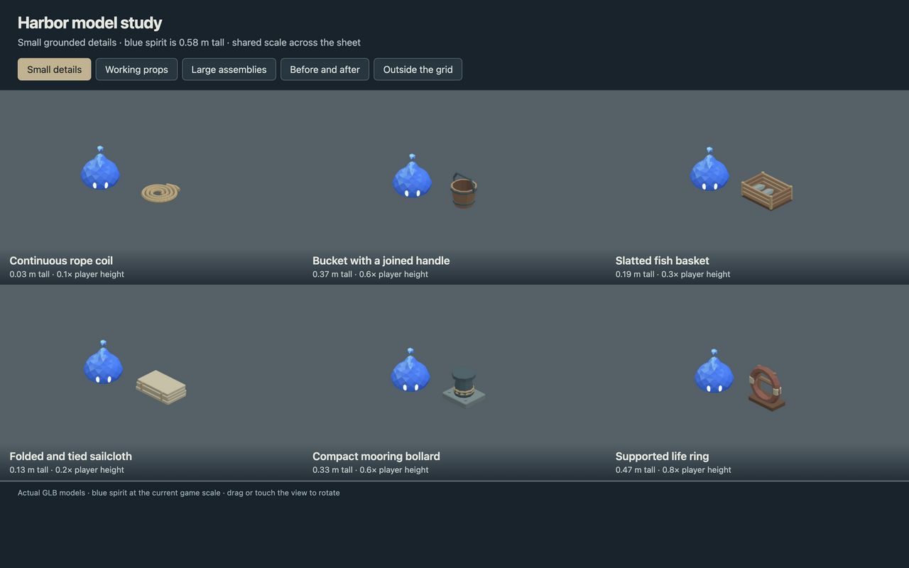
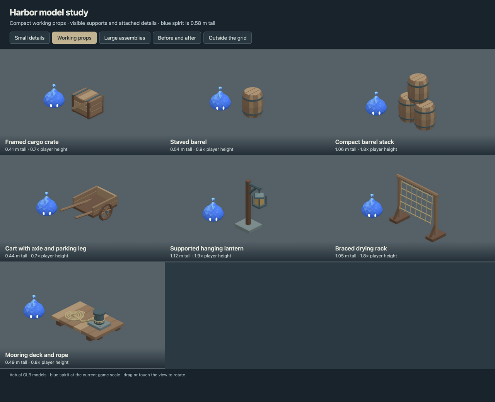
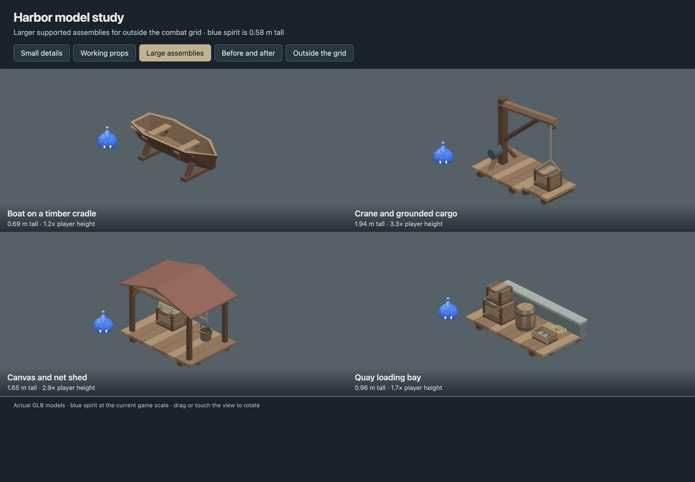
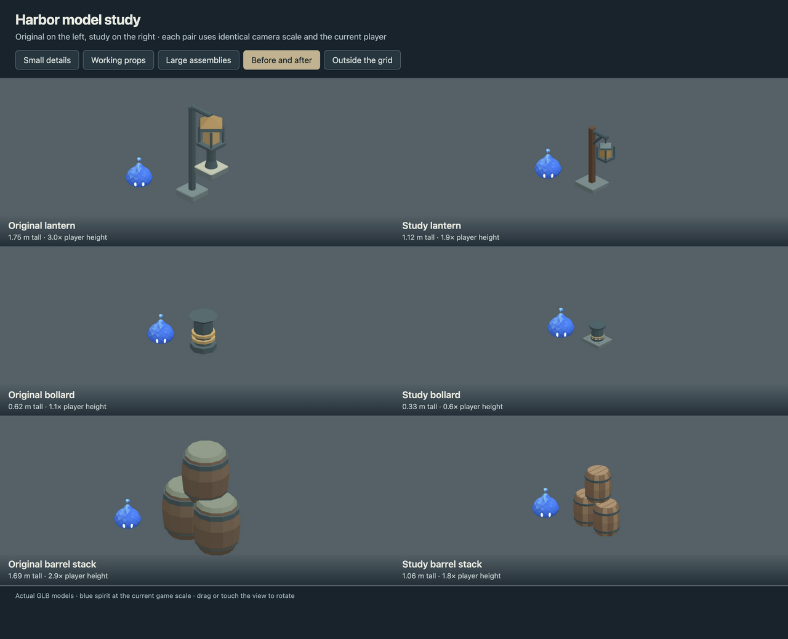
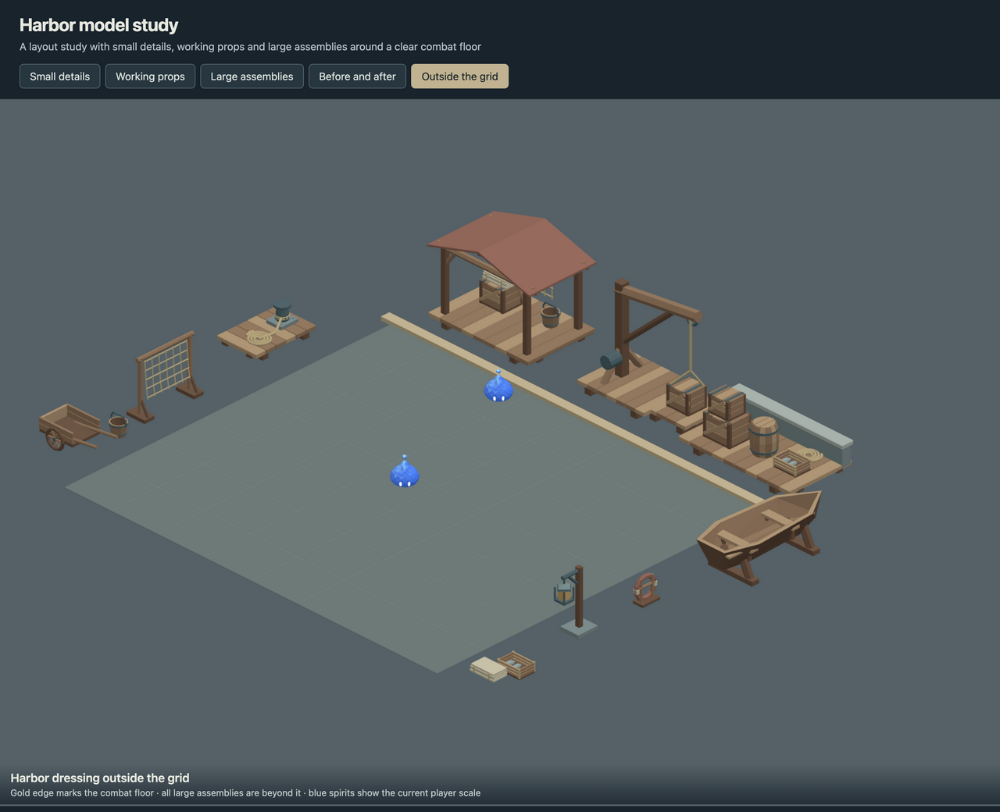

# Saltwind harbor study

Seventeen new models for feedback, built around the current player spirit's
0.5804 m height. The set combines small dressing, practical dock props and
larger assemblies intended for the arena perimeter.

| Group | Models |
| --- | --- |
| Small details (6) | Continuous rope coil, bucket, fish basket, folded sailcloth, bollard, supported life ring |
| Working props (7) | Cargo crate, barrel, barrel stack, handcart, lantern post, net rack, mooring deck |
| Large assemblies (4) | Boat on cradle, dock crane, canvas/net shed, quay loading bay |

## Review

Run `pnpm dev --host --port 5200`, then open
`/art/environment/saltwind-harbor-study/review.html` on that server.
The five views show small details, working props, large assemblies,
before/after comparisons and an exterior layout. Drag or touch the canvas
to rotate. The blue reference is the actual water spirit GLB through the
game's Puppet renderer, using the current environment/player scale.
Each comparison pair uses the same orthographic camera scale.

The exterior view reserves an 8 × 7 m floor; all twelve dressing placements
have model bounds outside it. Its editable arrangement is in `review.js`.
This exterior sheet is an art study. All seventeen models are also registered
in the revised playable harbor; see [in-game layout and previews](../studies/IN_GAME.md).







## Construction and files

The lantern has a metal hanger and braced arm. The boat rests on a cradle,
the cart has an axle and parking leg, the shed has rafters and roof supports,
and deck planks sit on cross-joists. The crane's load rests on its platform;
the rope connects the boom pulley and crate bridle. Small details touch their
supporting object or the ground.

`source/saltwind-harbor-study.blend` is the editable model library.
`models/` contains the exported GLBs. Every model has one mesh and one
vertex-color material, with no textures or animation. The study has its own
palette and ids; original source assets remain available alongside the new
game registrations and placements.

`support-audit.json` checks closed primitive contacts, intersections and
containment through a graph to ground, with a 2 mm tolerance. All 17 models
have zero unsupported primitives. This verifies geometric contact, not
load-bearing strength. Pieces remain intersecting/touching closed shells in
the joined mesh rather than a boolean-welded solid.

`verification.json` records export/reimport checks: manifold, positive-volume
shells, material/mesh counts, dimensions and hashes. All 17 exports passed.
The review was inspected in the network browser at desktop and 390 × 844
viewports; synthetic touch pointer events exercised rotation.

`pnpm check` passed typecheck and lint, but the existing 40-second replay test
hit its 5-second timeout under default parallelism. The complete suite passed
with `pnpm exec vitest run --maxWorkers 2`: 48 files, 374 tests.

## Rebuild and export

Run from the repository root. Building refuses to replace an existing source
unless `--replace-generated` is explicit; export manual Blender edits directly
if you want to preserve them.

```sh
/Applications/Blender.app/Contents/MacOS/Blender --background --threads 4 --python-exit-code 1 --python art/environment/saltwind-harbor-study/scripts/build.py -- --replace-generated
/Applications/Blender.app/Contents/MacOS/Blender --background --threads 4 --python-exit-code 1 --python art/environment/scripts/export.py -- --kit saltwind-harbor-study
/Applications/Blender.app/Contents/MacOS/Blender --background --threads 4 --python-exit-code 1 --python art/environment/scripts/verify.py -- --kit saltwind-harbor-study
```
