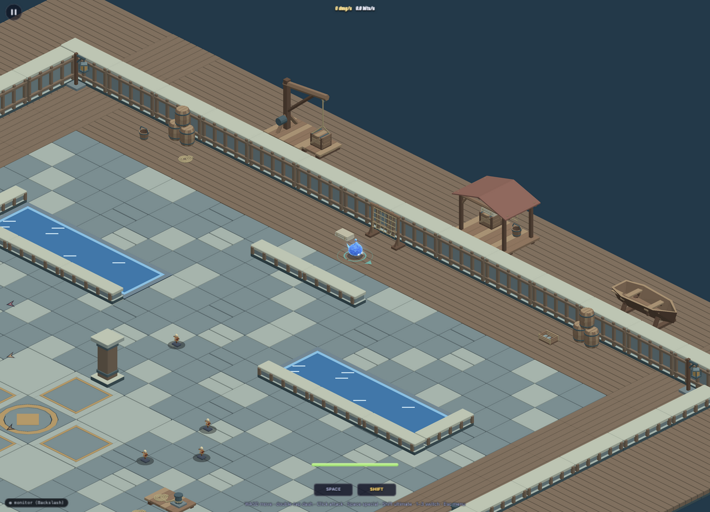
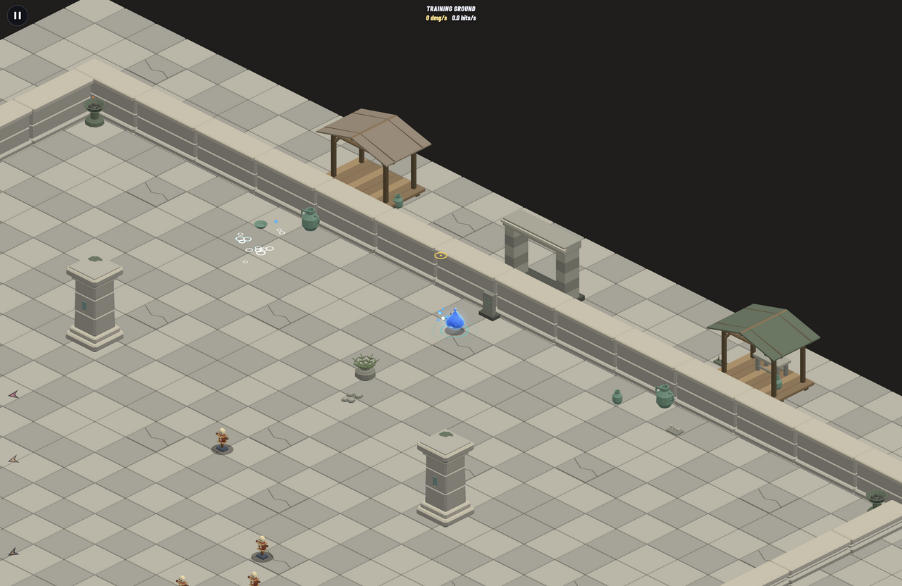
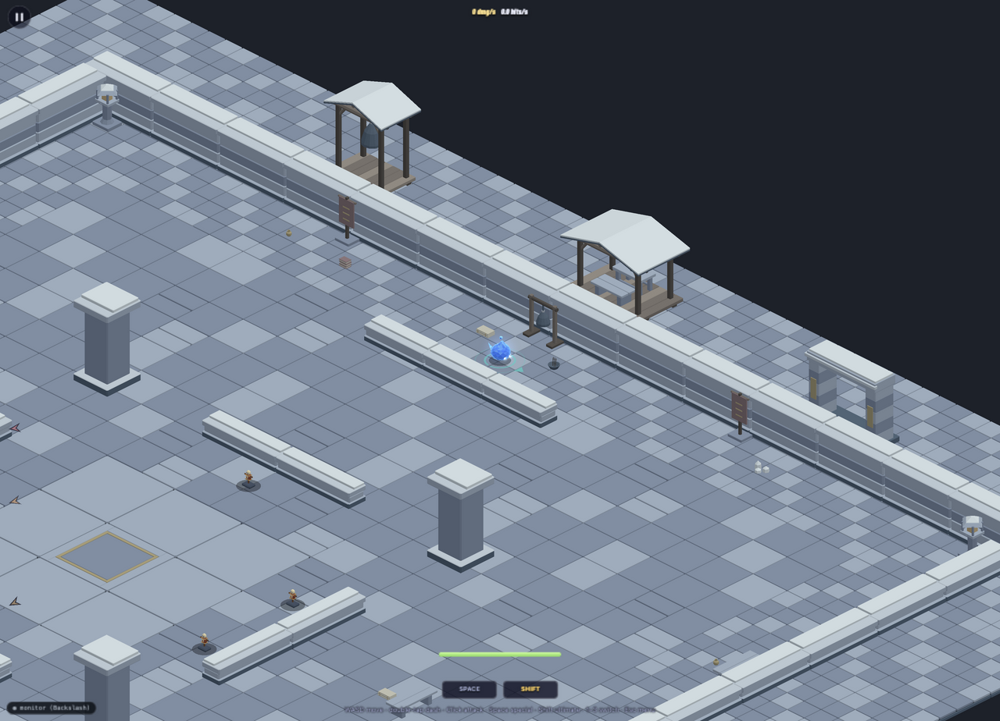

# Revised playable arenas

All 115 approved models are placed across the eight playable arenas. There are
105 solid props and 147 decorative placements, including four large exterior
assemblies per arena. The blue player in the previews is the current Tidecaller
spirit at normal game scale.

[Play the PR preview](https://top-down-team-shooter-game-pr-38-brqcxy4mo7wirtfd.lass-maglio.workers.dev/?play&arena=harbor&character=tidecaller)
or use the arena links below. These links fight all challenges in the selected
arena. Add `&challenge=trainingGround` for a quiet tour with training dummies.
On a desktop, `&touch` enables the phone controls with the mouse.

| Arena | Solid / decoration | What changed | Play | Desktop / phone previews |
| --- | ---: | --- | --- | --- |
| Courtyard | 13 / 18 | Four smaller pillars become planters and benches. Compact urns, braziers and tablets dress the walls; pergola, gate, alcove and fountain extend the ritual court outside. | [Play](https://top-down-team-shooter-game-pr-38-brqcxy4mo7wirtfd.lass-maglio.workers.dev/?play&arena=courtyard&character=tidecaller) | [Desktop](in-game/courtyard.png), [phone](in-game/phone/courtyard.png) |
| Flooded cistern | 12 / 18 | Supported pipes, pumps and valve stands frame the basins. A service bench and pump create interior cover; pump bank, manifold, canopy and settling tank continue the waterworks outside. | [Play](https://top-down-team-shooter-game-pr-38-brqcxy4mo7wirtfd.lass-maglio.workers.dev/?play&arena=cistern&character=tidecaller) | [Desktop](in-game/cistern.png), [phone](in-game/phone/cistern.png) |
| Ember kilnworks | 12 / 18 | Low casting bench, compact anvil and boiler form work bays around the existing fire trenches. Tools and ingots stay walkable; furnace, forging shelter, chimney and casting station ground the exterior foundry. | [Play](https://top-down-team-shooter-game-pr-38-brqcxy4mo7wirtfd.lass-maglio.workers.dev/?play&arena=kilnworks&character=tidecaller) | [Desktop](in-game/kilnworks.png), [phone](in-game/phone/kilnworks.png) |
| Overgrown sanctuary | 13 / 21 | Rooted trees replace four corner pillars. Logs, shrines, stumps and timber seats shape the edges; leaves, ferns and fungi soften the ground. Root arch, shrine grove, ruin and mushroom garden sit outside. | [Play](https://top-down-team-shooter-game-pr-38-brqcxy4mo7wirtfd.lass-maglio.workers.dev/?play&arena=sanctuary&character=tidecaller) | [Desktop](in-game/sanctuary.png), [phone](in-game/phone/sanctuary.png) |
| Saltwind harbor | 15 / 17 | Compact cargo and a mooring deck replace two pillars. Barrels, net rack, cart and dock fittings provide cover; rope, buckets, baskets and cloth remain walkable. Crane, shed, grounded boat and loading bay complete the dockside yard. | [Play](https://top-down-team-shooter-game-pr-38-brqcxy4mo7wirtfd.lass-maglio.workers.dev/?play&arena=harbor&character=tidecaller) | [Desktop](in-game/harbor.png), [phone](in-game/phone/harbor.png) |
| Ochre necropolis | 12 / 18 | A fitted coffin and folded-wing guardian add cover around the obelisk ring. Smaller burial goods replace oversized edge dressing; gate, awning, sun altar and burial dais stand beyond the walls. | [Play](https://top-down-team-shooter-game-pr-38-brqcxy4mo7wirtfd.lass-maglio.workers.dev/?play&arena=necropolis&character=tidecaller) | [Desktop](in-game/necropolis.png), [phone](in-game/phone/necropolis.png) |
| Basalt citadel | 15 / 18 | Restrained banners replace four outer pillars. Equipment racks, a planning table and compact crates shape approaches, while cloth and pouches remain decorative. Supported ram, shelter, throne dais and battlement bay form an exterior siege yard. | [Play](https://top-down-team-shooter-game-pr-38-brqcxy4mo7wirtfd.lass-maglio.workers.dev/?play&arena=citadel&character=tidecaller) | [Desktop](in-game/citadel.png), [phone](in-game/phone/citadel.png) |
| Frostbound monastery | 13 / 19 | Low benches, attached bells, lanterns and prayer boards furnish the cloister without closing its passages. Tea, books, mats and firewood stay decorative; pavilion, bell tower, gate and hearth extend the winter court. | [Play](https://top-down-team-shooter-game-pr-38-brqcxy4mo7wirtfd.lass-maglio.workers.dev/?play&arena=monastery&character=tidecaller) | [Desktop](in-game/monastery.png), [phone](in-game/phone/monastery.png) |

## How placement works

Solid furniture, cargo, trees and machinery use the existing simulation's prop
boxes for character, enemy and projectile collision. Boxes follow each model's
rotated footprint and cover its visible size, with a small margin for corners.
They do not reproduce gaps between individual legs or branches.

Small ground details are batched scenery, with no movement or projectile
collision. Tall decorative assemblies stand entirely beyond the boundary walls,
on two extra rows of floor tiles. The combat rectangle and hazard footprints
keep their existing dimensions. Enemy and player batches remain unchanged.

Models with offset origins, such as the crane and handcart, receive a rotated
footprint-center correction so rendering agrees with the simulation's position.
The exterior floor remains presentation-only; actors cannot walk into it.

`layouts.json` records the placements. `integrate.py` registers the verified
exports and writes literal arena content and presentation mappings. To update
one arena, run `python3 art/environment/studies/integrate.py <arenaId>`; running
without an arena updates the asset registry. Model paths stay in presentation.

## Review and validation

- `env VITEST_MAX_WORKERS=2 pnpm check`: typecheck and lint passed; 428 tests passed in 53 files. One new route-check case is skipped for the training layout, which has no new study props.
- `pnpm build` passed. The existing Vite warning about the main JavaScript chunk exceeding 500 kB remains.
- Route checks use the actual swept-circle collision code and the widest 40-unit body. Existing gap, spawn and hazard checks pass for all layouts.
- Export bounds are checked against the extended floor and boundary walls. Indoor study decoration is below 0.4 m; large assemblies stay outside the combat grid.
- The real exported crane exercises footprint centering at every quarter turn, batch registration, hazard tile holes and disposal.
- Browser review used the network URL at 1800 × 1300 and 390 × 844. All eight arenas rendered without horizontal overflow and accepted touch movement. The harbor also exercised attacks in a live Swarm encounter: [combat preview](in-game/phone/harbor-combat.png).
- A browser collision comparison moved the same player north through the courtyard bowl and toward the urn. Decoration allowed the player to reach the boundary at y=16.01; the solid urn stopped the player at y=42.01, matching its collision box plus body radius.

Screenshots use the game's normal camera and player scale, with the player
temporarily placed near the north perimeter for inspection. Touch checks used
synthetic pointer events; pointer capture was temporarily stubbed for those
events and restored afterward. Physical-phone performance has not been measured.
The original art support audits and GLB verification remain available per kit.

