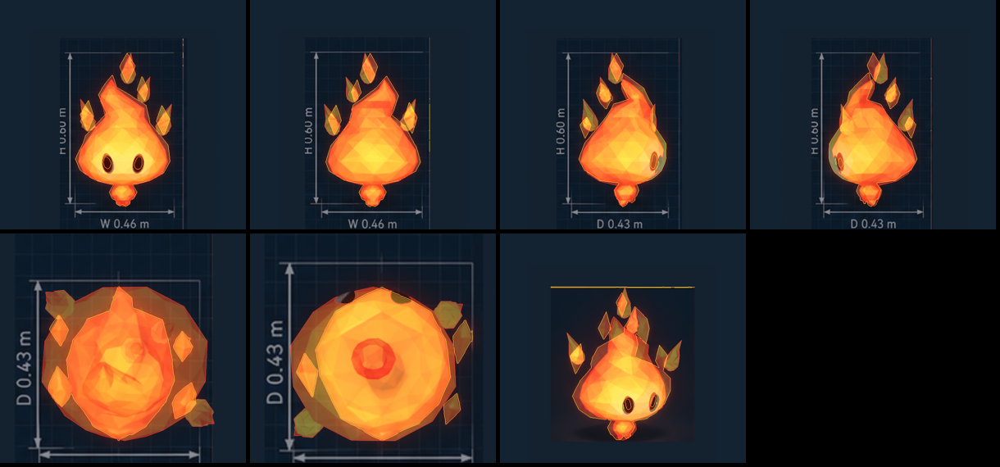
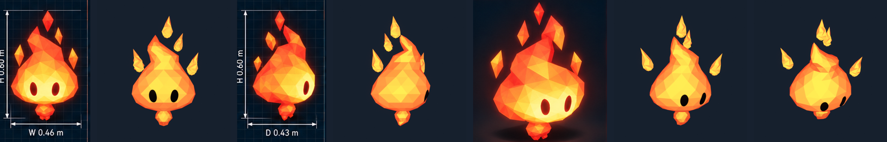

# Fire spirit

The fire character's spirit: a faceted low-poly flame with dark eyes, an
ember nub hanging under it, and four floating shards. Built only from its
production model sheet (`reference/sheet.png`; the other images in
`reference/` are its views, cropped). Model only, for now.



The model rendered from each of the sheet's cameras and laid on its view
(front, back, left, right, top, bottom, and the isometric render; sheet
outlines yellow, model red). Beside the sheet, and at the game's camera:



## From the sheet

1. `sheet.py` measures the front, back, left, and right views into
   `sheet.json`: each outline row by row (the body with the nub under its
   narrow neck), the shards, and the eyes (the holes in the body), and the
   top view's shards.
2. `build.py` lofts the body and nub through the outlines (left and right
   from the front and back views, front and back from the left view: the
   right view is its mirror image): each ring an ellipse round its section's
   center, so the head rises to a pointed tip leaning as the sheet draws it,
   while below the flame it is centered, for a symmetric face. It places
   the four shards as small flames (faceted teardrops curling outward, each
   its own object, to float) where the front, left, and top views put them,
   around the pointed head; and lays the dark eyes on the surface (`Eye.L`,
   `Eye.R`, to blink later), one size, mirrored.
3. Colors are the swatches: each facet orange to ember red (redder toward
   the tip and on the nub), and the material glows from within: warm yellow
   where it faces the camera, ember red at the silhouette's edges.
4. `sweep_score.py` finds the isometric render's camera (30° round, 10° up);
   `overlay.py` lays each render on the sheet's view and scores the
   overlap: front 82%, back 84%, left 81%, right 78%, the isometric render
   66%, top 61%, bottom 70% (lower than before: the shards are flames now,
   not the sheet's diamonds, and the face is centered).

**Where the sheet disagrees with itself.** Its top and bottom views draw the
body narrower than its front and side views do (about 0.33 m across from
above, against 0.37 m from the front, at the same scale), so a model true to
the side views is too round from above. The isometric render is drawn with
a taller flame tip than the side views give.

## Rebuild

```sh
uv run --with pillow --with numpy art/spirits/fire/sheet.py                      # sheet.json
blender --background --python-exit-code 1 --python art/spirits/fire/build.py     # fire-spirit.blend
SWEEP=/tmp/sweep blender --background --python art/spirits/fire/render.py        # isometric camera candidates
uv run --with pillow --with numpy art/spirits/fire/sweep_score.py /tmp/sweep     # its camera, into sheet.json
blender --background --python-exit-code 1 --python art/spirits/fire/render.py    # renders/
uv run --with pillow --with numpy art/spirits/fire/overlay.py                    # renders on the sheet, scored
```
