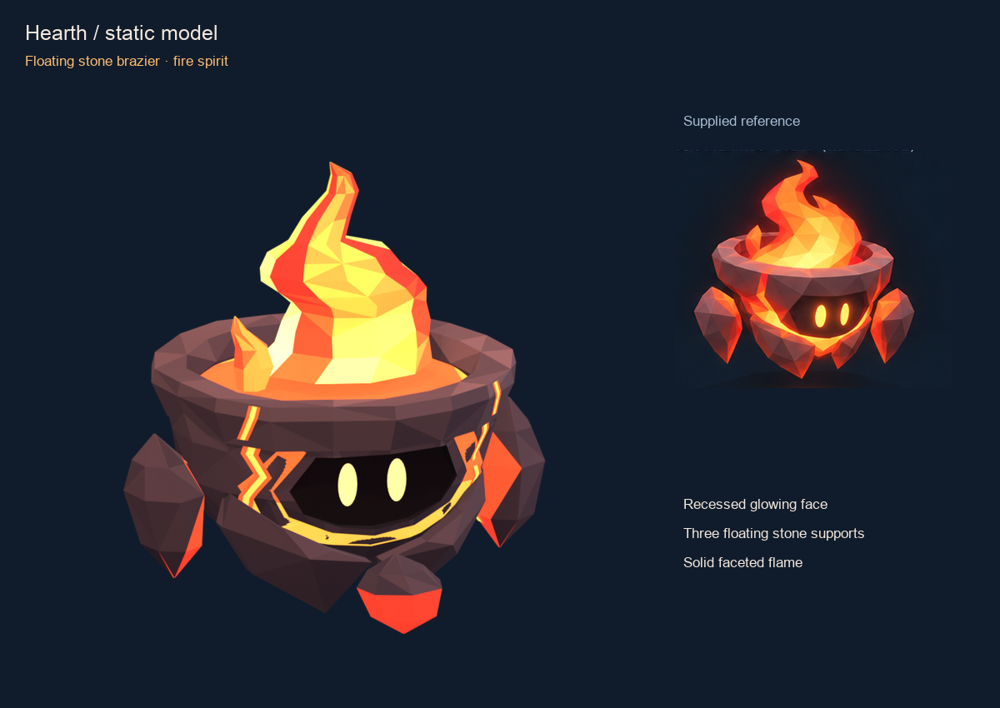

# Hearth spirit

Hearth modeled from the supplied Fire Spirit sheet. A thick, open stone
brazier holds a solid faceted flame. The face is cut into the tapered body,
with two warm oval eyes on its inset backing. Two broad side stones and a
smaller front stone float around it. Angular jaw plates belong to the bowl.

The approved model now has ten object animation clips. The stone bowl
stays rigid, while its flame flickers and flares from a pivot inside the
basin. The floating stones drift, trail during movement and open during
healing casts. The eyes blink and react without leaving the face recess.

Open [the animation inspector](animation.html) through Vite. It loads
`hearth-animated.glb` and offers each clip, pause, scrubbing, playback
speed, a sequence of all clips, camera controls and a 32 px view.

- [Animated GLB](hearth-animated.glb)
- [Editable animation source](hearth-animated.blend)
- [Animation contact poses](renders/animation-poses.png)
- [All clips in motion](renders/hearth-animation-preview.mp4)
- [32 px and 64 px samples](renders/animation-game-size.png)
- [Clip metadata](animation.json) and [animation audit](animation-verification.json)

| Clip | Last key | Loop length | Motion |
| --- | --- | --- | --- |
| Idle | 2.967 s | 3 s | Calm hover, flicker, stone drift, blink |
| Run | 0.767 s | 0.8 s | Hover lean, trailing flame and stones |
| AttackA / AttackB | 0.367 s | One-shot | Mirrored recoil and flame pulse |
| AttackC | 0.533 s | One-shot | Finishing recoil and flare |
| Power | 0.533 s | One-shot | Strong charged flare |
| Dash | 0.367 s | One-shot | Forward lean and a soft brake |
| Hurt | 0.3 s | One-shot | Recoil, narrowed eyes, flame dip |
| Cast | 0.367 s | One-shot | Warm healing pulse |
| Ultimate | 0.567 s | One-shot | Gather, rise, beacon flare, settle |

The attack contact poses use the existing spirit convention at 30 fps,
frame 4 for AttackA/B and frame 6 for AttackC/Power. Simulation owns
movement and combat timing. Every clip plays in place; the bowl's
horizontal translation is constant. One-shots start and end at the
approved rest pose. Loops omit their closing key, as required by
`docs/models.md`. Consumers must close Idle at 3 s and Run at 0.8 s using
the generated timing. The inspector restores those keys using the game's
`closeLoop` convention.

The animated source keeps seven meshes with editable NLA tracks, ten per
object. The bowl parents the other six parts. Enable one named NLA track
on every mesh to review a clip in Blender. Tracks are saved muted so the
file opens at the approved rest pose. The original static source keeps
all 23 separate pieces for geometry editing.

Hearth has no character content id in this checkout. The animated asset
and inspector are ready for review; runtime registration and gameplay
wiring remain a separate step.



Open [the interactive viewer](index.html) through Vite. It loads the actual
static GLB, with orbit controls, sheet cameras, true level cameras, wireframe,
optional review bloom and a 32 px mode. The glow toggle changes the viewer's
bloom; the flame's colored facets and molten seams are part of the asset.

- [Editable Blender source](hearth-spirit.blend)
- [Static GLB](hearth-spirit.glb)
- [Reference comparison](renders/review-reference.png)
- [Every angle](renders/review-angles.png)
- [Game-camera samples](renders/review-game-size.png)
- [Original supplied sheet](reference/sheet.png)
- [Export metadata](export.json) and [geometry audit](verification.json)

The GLB has 2,982 triangles, seven mesh nodes, four shared materials and
twelve primitives. It uses vertex colors and embeds no textures. The
visible figure is 0.80 m tall, with its lowest stone 0.08 m above the ground
origin. Its full height from that origin, including the flame, is 0.88 m.
The silhouette is approximately 0.80 m wide. Exact bounds are in the export
metadata. The native file uses Blender +Z up and -Y forward; the GLB uses
+Y up and +Z forward.

The original static files contain no rig or animation clips. Their source
preserves the bowl, jaw plates, flame
lobes, supports, eyes and surface seams as editable pieces. The exporter
combines the body details and joins each support's seam to its stone,
keeping seven named nodes, also used by the animated version.

## Reading the sheet

`sheet.py` crops the seven supplied views and records pixel anchors,
silhouette rows and flame widths in `sheet.json`. The front silhouette is
301 px high; that sets the 0.80 m model scale. The rim is approximately
246 px wide. The three-support layout follows the top and bottom views.
The flame keeps its asymmetric curl in both horizontal axes, so its shape
is visible from the sides.

The sheet's cardinal pictures show the bowl opening, so their comparison
cameras sit 10 degrees above horizontal. The side pictures are also turned
toward the face. The viewer labels those presets "Sheet left" and "Sheet
right"; separate level cameras show the actual orthographic geometry.
The hero camera is 16 degrees up, and the game camera is 30 degrees up.

The supplied views disagree on apparent depth, the size of the small
support, and which side exposes the face. This model keeps one coherent
bowl and one forward-facing recess. The eyes are mirrored and centered.
`reference-review.json` records the camera settings and silhouette overlap
for every comparison. The current overlap is about 84% at the front and
85% at the back, with lower side scores. These measurements are diagnostics
for shape, not a claim about matching every drawn facet or glow.

The stone palette runs from dark plum to warm brown. Flame and seam colors
run from red-orange to pale yellow. The flame and eyes use glTF's unlit
material extension to preserve their colored emission under different
lights. The stone uses a rough vertex-colored material; the recess has its
own dark material. Cameras, lights, shadows and bloom in the review are
not exported.

## Rebuild

From the repository root, with Blender 4.5 LTS and `uv`:

```sh
uv run --with pillow --with numpy art/spirits/hearth/sheet.py
/Applications/Blender.app/Contents/MacOS/Blender --background --python-exit-code 1 --python art/spirits/hearth/build.py
/Applications/Blender.app/Contents/MacOS/Blender --background --python-exit-code 1 --python art/spirits/hearth/export.py
/Applications/Blender.app/Contents/MacOS/Blender --background --python-exit-code 1 --python art/spirits/hearth/verify.py
/Applications/Blender.app/Contents/MacOS/Blender --background --python-exit-code 1 --python art/spirits/hearth/render.py
uv run --with pillow --with numpy art/spirits/hearth/review.py
/Applications/Blender.app/Contents/MacOS/Blender --background --python-exit-code 1 --python art/spirits/hearth/animate.py
/Applications/Blender.app/Contents/MacOS/Blender --background --python-exit-code 1 --python art/spirits/hearth/verify_animation.py
/Applications/Blender.app/Contents/MacOS/Blender --background --python-exit-code 1 --python art/spirits/hearth/render_animation.py
uv run --with pillow art/spirits/hearth/review_animation.py
pnpm dev --host --port 5208 --strictPort
```

Open `/art/spirits/hearth/index.html` on the printed network address.
The animated inspector is `/art/spirits/hearth/animation.html`.
`render.py -- front,hero` renders only those named views for iteration.
The scripts are self-contained and do not change the shared spirit tools.

## Validation

The animation audit compares every exported triangle corner, vertex color
and material against the approved static GLB. The largest rest position
difference is below one micrometer. It samples the actual GLB channels at
120 Hz, including quaternion interpolation, to check constant horizontal
root translation, rigid bowl scale, attached eyes, finite transforms,
ground clearance and rest recovery. Minimum clearance is 0.0478 m. Both
loops close exactly after restoring the first key. The source audit checks
the mesh hierarchy and all 70 editable NLA tracks.

The native static geometry audit checks closed solid parts, flat triangular
faces, no degenerate faces or loose vertices, symmetric eyes on the
recessed backing, and no animation or helper objects. Molten seam strips
are intentional open surface details. The GLB audit checks the triangle
budget, seven mesh nodes, four materials, vertex colors, forward-facing
eyes, unlit colored flame, no skins, clips, textures or compression, and
matching bounds after importing the export back into Blender.

The network browser review checked loading, camera presets, wireframe and
phone layouts at 390 × 844 and 844 × 390. Touch orbiting was tested with
synthetic touch PointerEvents, with pointer capture stubbed during that
probe. This is browser evidence, not physical-phone performance evidence.
`browser-review.json` records the export hash and saved captures.

`animation-browser-review.json` records the animated export's network
browser review. All ten clips stay within both the hero and game cameras.
Phone portrait and landscape layouts have no horizontal overflow. The
portrait review includes synthetic touch orbiting and the 32 px view.
Saved screenshots and an actual GLB playback recording are in `renders/`.
The animation inspector scrolls its controls independently on desktop so
the model stays visible. Some desktop snapshot requests failed in the
preview tool; browser evaluation, later captures and recording worked.

`pnpm check --maxWorkers=2` passed typecheck, lint and 565 tests, with one
existing skipped test. `pnpm build` passed with the existing bundle-size
warning. These checks passed again after adding animation. The main game
build does not include Hearth until it is registered for a character.
Only files under `art/spirits/hearth/` belong to this change.
