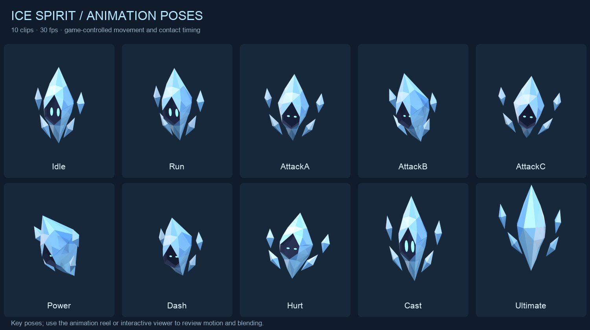
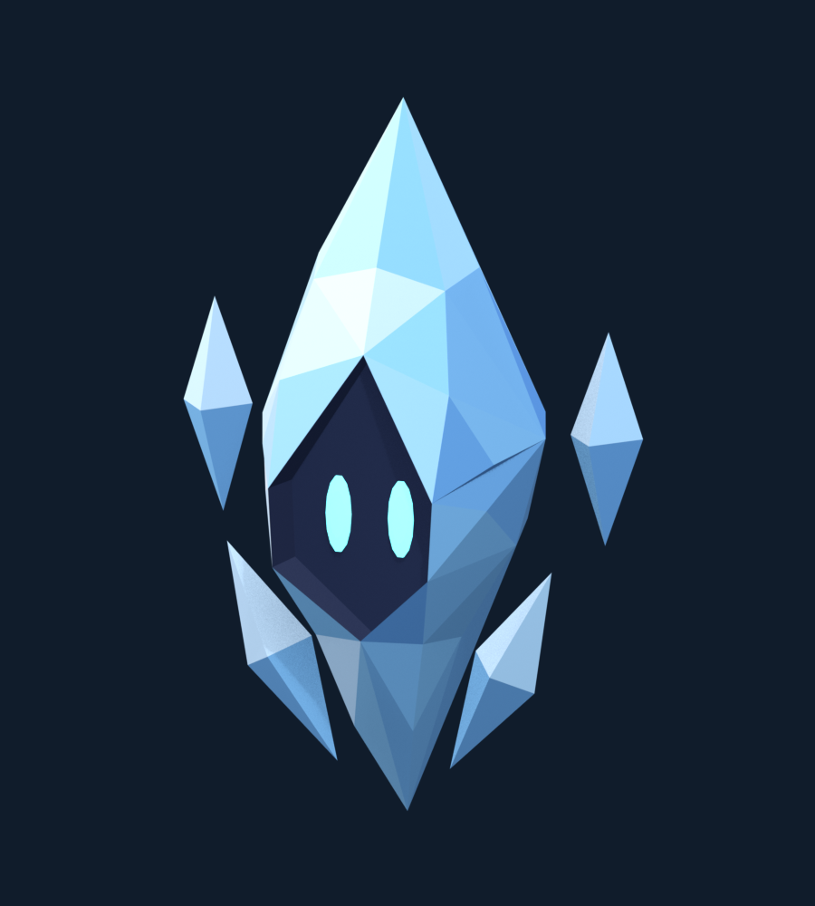

# Ice Spirit

Ice Spirit built from the supplied production sheet, with the ten clips
used by the game's spirit player. Animated source:
[ice-spirit-animated.blend](ice-spirit-animated.blend). Game export:
[ice-spirit-animated.glb](ice-spirit-animated.glb).

Open [index.html](index.html) through Vite to play each clip, scrub a pose,
change speed, preview the sequence, or enable the actual game's blending.
It also has camera presets, wireframe, and a 32 px view.

## Animation delivery

| Clip | Motion |
| --- | --- |
| Idle | Gentle hover, independent shard bobs, mirrored blink; 2 s loop |
| Run | Forward lean, narrow stretch, shards trailing; 0.533 s loop |
| AttackA / AttackB | Mirrored windup and crystal strike; contact at frame 4 |
| AttackC | Larger combo finisher; contact at frame 6 |
| Power | Stronger charged strike; contact at frame 6 |
| Dash | Forward stretch with trailing shards and narrowed eyes |
| Hurt | Knockback, squash, and eye recovery |
| Cast | Immediate lift and shard spread |
| Ultimate | Immediate leap, full turn, shard expansion, and landing |



[Animation reel](renders/animation-preview.mp4) records the exported GLB
through the game's `Puppet` player. The crown stays joined to the body;
eyes follow the recessed face; all four detached shards have local motion.
The approved static files and their geometry remain unchanged.

Clips are object animation at 30 fps, with linear sampled keys and no
skeleton. Every combat clip returns to rest. Body lean is bounded to the
character's footprint; travel, action duration, contact timing, and
hitboxes belong to the simulation. Entrance, switching, and falling use
the existing presentation effects. The animated Blender scene uses +Z up,
-Y forward; its GLB uses +Y up, +Z forward. Children have local transforms
relative to the body's pivot. Constant channels are retained so Run's
stretch exports and a prior blink cannot leave the eyes shut.

`src/presentation/assets/ice-spirit.ts` contains generated timing and
height. `models.iceSpirit` registers the GLB and pale blue glow. This is a
ready animation asset; no Ice character kit or content entry is introduced.
Assign it to a character in `looks.ts` when that character's kit is defined.

The runtime contact test exposed a quaternion aliasing bug in `Puppet`:
blending copied the outgoing rotation over the target before reading it.
The player now blends toward its separately saved target quaternion.

### Rebuild animations

After the approved static source exists, run from the repository root:

```sh
/Applications/Blender.app/Contents/MacOS/Blender --background --python-exit-code 1 --python art/spirits/ice/export-animated.py
/Applications/Blender.app/Contents/MacOS/Blender --background --python-exit-code 1 --python art/spirits/ice/verify-animated.py
/Applications/Blender.app/Contents/MacOS/Blender --background --python-exit-code 1 --python art/spirits/ice/render-animation.py
uv run --with pillow art/spirits/ice/review-animation.py
pnpm dev --host --port 5218 --strictPort
```

`animate.py` defines Ice's hover and shard motion and uses the shared spirit
combat poses. `animation.json` records timing, contacts, rest transforms,
dimensions, and source/export hashes. `verification-animated.json` audits
all ten clips, hierarchy, topology, palette, and unchanged static files.
Record the viewer's **Preview all** with **Game blending** enabled to
refresh the animation reel after edits.

### Animation verification

`pnpm check --maxWorkers=2` passes: 69 files, 569 tests passed, one skipped.
`pnpm build` passes. The focused GLB tests check rest dimensions and
parenting, floor clearance, loop closure, no horizontal loop travel,
blink recovery, Run stretch, immediate skill lift, attack contact poses
through `Puppet`, and freeze behavior.

The live viewer was reviewed at 1280×800 and 390×844 on Vite's network
address. Phone controls have 44 px targets and no horizontal overflow;
scrubbing and synthetic touch orbit work. The reel is browser evidence,
not physical-device performance or a gameplay review of an Ice kit.

## Approved static model

Editable source: [ice-spirit.blend](ice-spirit.blend). Static export:
[ice-spirit.glb](ice-spirit.glb). The following measurements and reviews
document that approved pass.



## Shape and reference decisions

The model preserves the long crystal crown, broad hood around the face,
pointed lower body, two upright upper shards, two diagonal lower blades,
dark indigo recess, and two tall cyan eyes. Colors are sampled from the
sheet's swatches. Each ice plane has a flat vertex color. The eyes use pale
cyan emission to reproduce the drawing's luminous centers.

The front drawing supplies the traced X/Z landmarks in `sheet.json`.
The labels give an overall height of 0.80 m, width of 0.55 m, and depth of
0.35 m. The drawing's pixel proportions do not agree with those labels,
so width and height use separate pixel-to-meter scales. The model is
slightly narrower in proportion than the original picture. The comparison
preserves that visible difference; only the scored overlay normalizes the
reference to the stated width and height.

Several smaller labels also conflict with the drawing. A 0.30 m body
width, the 0.15 m crown, and shard offsets of ±0.21 m do not reproduce the
pictured proportions at the stated overall size. The drawing wins for
part shape and position. The upper shard pivots are approximately ±0.23 m;
the lower blades are closer to the body, approximately ±0.13 m. The crown
is separate but joins flush, because the image shows a continuous point.
The side drawing is oblique and does not establish an orthographic side
silhouette. No back view is supplied. The rear continues the closed
crystal volume with a keel and triangular facets, without extra ornaments.

The front silhouette scores **94.8% intersection over union** against the
dimension-normalized reference mask, including the four detached shards.
This measures silhouette, not color, face accuracy, or resemblance from
every camera. See [the comparison](renders/review-reference.png),
[all angles](renders/review-angles.png), and
[game-size samples](renders/review-game-size.png).

## Asset contract

| Property | Value |
| --- | --- |
| Stage | Approved static geometry |
| Dimensions | 0.80 m high × 0.55 m wide × 0.35 m deep |
| Triangles | 1,194 |
| Objects | 8 independently positioned meshes |
| Materials | 3 shared materials, 9 glTF primitives |
| Native Blender axes | Meters, +Z up, +Y forward |
| GLB axes | Meters, +Y up, +Z forward |
| World origin | Center of the lowest crystal tip, exactly at ground |
| Height basis | Ground origin to the highest rest mesh vertex, including crown |
| Shading | Flat on every face; vertex-color ice palette |
| Rig, animation, UVs, textures, helper objects | None |

`IceSpirit` has its pivot at `(0, 0, 0.45)` m. Its front surface surrounds
an actual opening, with a bevel and backing about 5.8 cm below the outer
lip. There is no hidden intact ice surface behind the eyes.
`Crown` has its pivot at `(0, 0, 0.73)` m. `Shard.Upper.L`,
`Shard.Upper.R`, `Shard.Lower.L`, and `Shard.Lower.R` have centered local
pivots. `Eye.L` and `Eye.R` are mirrored thin ellipsoids with their own
centered pivots. These names are suitable for later object animation;
Three.js sanitizes dots when loading them.

The `.blend` preserves the sheet's native +Y-facing convention. Export
temporarily rotates the objects 180° about native Z before Blender's glTF
axis conversion, producing a +Z-facing GLB. The saved source stays +Y
facing. `export.json` records exact bounds, pivots, triangle counts, and
the static GLB hash. The static export contains no animation.

## Rebuild

From the repository root, with Blender 4.5 LTS and `uv`:

```sh
uv run --with pillow --with numpy art/spirits/ice/sheet.py
/Applications/Blender.app/Contents/MacOS/Blender --background --python-exit-code 1 --python art/spirits/ice/build.py
/Applications/Blender.app/Contents/MacOS/Blender --background --python-exit-code 1 --python art/spirits/ice/export.py
/Applications/Blender.app/Contents/MacOS/Blender --background --python-exit-code 1 --python art/spirits/ice/verify.py
/Applications/Blender.app/Contents/MacOS/Blender --background --python-exit-code 1 --python art/spirits/ice/render.py
uv run --with pillow --with numpy art/spirits/ice/review.py
pnpm dev --host --port 5217 --strictPort
```

Open `/art/spirits/ice/` on the network address printed by Vite. The viewer
loads the GLB using its export hash to avoid showing a cached earlier pass.
Review PNGs document this static pass and must be regenerated after edits.

## Verification

`verify.py` passes for all eight native meshes: closed manifold surfaces,
no degenerate faces or loose vertices, triangles only, and no smoothing.
It reads the binary GLB to check triangle counts, materials, vertex colors,
and absence of animation, skeletons, textures, cameras, lights, and Draco.
It imports the GLB back into Blender to verify scale, orientation, and the
ground point. Results are in [verification.json](verification.json).

`pnpm check --maxWorkers=2` passed: 68 test files, 565 tests passed,
one skipped. `pnpm build` passed. The initial check used the existing
checkout's incomplete dependencies and failed on missing SQL packages;
installing the locked dependencies in this worktree resolved it.

The final GLB was reviewed in the collaborative browser on the network
address, with desktop and 390×844 phone layouts. Camera presets, wireframe,
32 px framing, and simulated touch orbit were checked. Touch used synthetic
PointerEvents with pointer capture stubbed during dispatch. It is a browser
handler check, not a physical phone check. Preview screenshot capture failed;
visual inspection used the browser canvas and the fresh Blender renders.
No physical-device performance or gameplay review is claimed for this
static asset.
