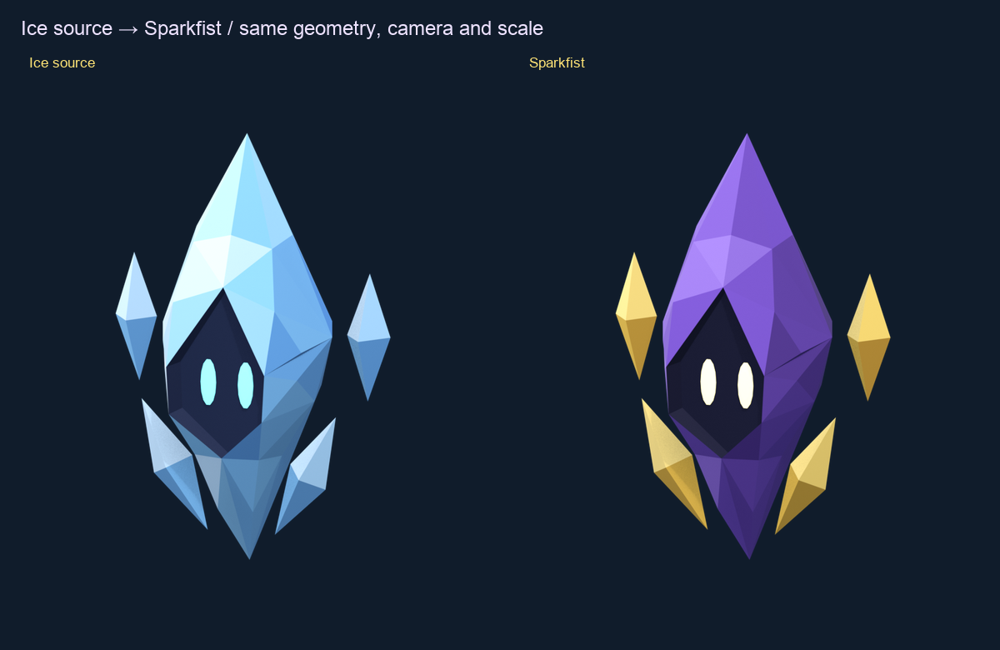

# Sparkfist static model

The approved Ice Spirit adapted for Sparkfist's thunder element. This pass
changes the palette to violet and gold, warms the glowing eyes, and adds a
small gold lightning mark on the rear. The pointed silhouette, crown,
four floating shards, face recess and part pivots are preserved.



Open [the viewer](index.html) through Vite to orbit the static GLB,
switch between Sparkfist and the Ice source under the same camera and
lights, inspect wireframe, and check the 32 px framing.
[All angles](renders/review-angles.png) and
[game-size samples](renders/review-game-size.png) use actual Blender renders.

The editable source is [sparkfist-spirit.blend](sparkfist-spirit.blend).
The static export is [sparkfist-spirit.glb](sparkfist-spirit.glb).
It has 1,218 triangles, eight mesh objects, three shared materials and
nine GLB primitives. Rest dimensions remain 0.80 m high, 0.55 m wide and
0.35 m deep. The ground origin, native +Y facing and exported +Z facing
match the Ice source.

The existing Ice animation files are unchanged. The inherited `IceSpirit`,
`Crown`, shard and eye node names remain because the animation recipe
binds to them. The rear bolt is a closed mesh joined to the body, sharing
its material, so it follows the body's clips without another animation
track. No new animated export or character look is introduced in this
static review.

The recolor preserves the original broad facet colors across their
subdivided triangles. Body shades range from dark violet to lilac;
floating shards range from amber to pale gold. The face stays dark for
contrast with the warm eyes. [adaptation.json](adaptation.json) records the
palette and source hash.

## Rebuild

Run from the repository root with Blender 4.5 LTS and uv:

```sh
/Applications/Blender.app/Contents/MacOS/Blender --background --python-exit-code 1 --python art/spirits/sparkfist/build.py
/Applications/Blender.app/Contents/MacOS/Blender --background --python-exit-code 1 --python art/spirits/sparkfist/export.py
/Applications/Blender.app/Contents/MacOS/Blender --background --python-exit-code 1 --python art/spirits/sparkfist/verify.py
/Applications/Blender.app/Contents/MacOS/Blender --background --python-exit-code 1 --python art/spirits/sparkfist/render.py
uv run --with pillow art/spirits/sparkfist/review.py
pnpm dev --host --port 5221 --strictPort
```

The exporter, topology audit and render cameras follow the source asset's
tools. The build reads the approved Ice Blender source directly and writes
only this folder.

## Verification

[verification.json](verification.json) checks closed manifold surfaces,
flat shading, no loose vertices or degenerate faces, all original vertex
positions and pivots, triangle count, vertex colors, hash, dimensions,
ground origin and facing after a GLB round trip. The static GLB has no
animation, skeleton, textures, cameras or lights.

`pnpm check --maxWorkers=2` passed with 83 test files and 688 tests passed,
one skipped. `pnpm build` passed. This asset is a review export, so the
production build does not bundle it yet.

The exported GLB loaded on Vite's network address at desktop and 390×844
phone sizes. Camera presets, the source comparison, 32 px framing and
synthetic touch orbit were checked. Phone buttons are at least 44 px tall,
with no horizontal overflow. Touch used synthetic PointerEvents with
pointer capture temporarily stubbed. Browser screenshot capture failed;
visual review uses the fresh Blender renders. This is static asset and
browser-handler evidence, without a physical-device or gameplay check.
