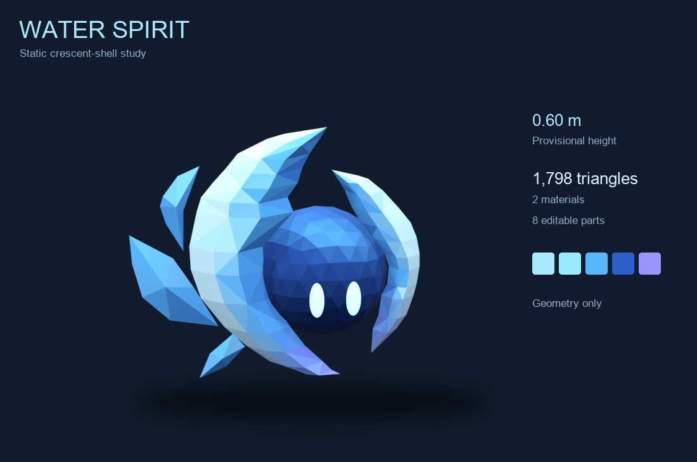
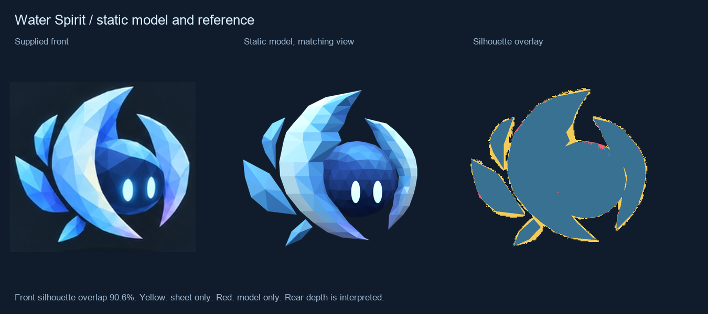
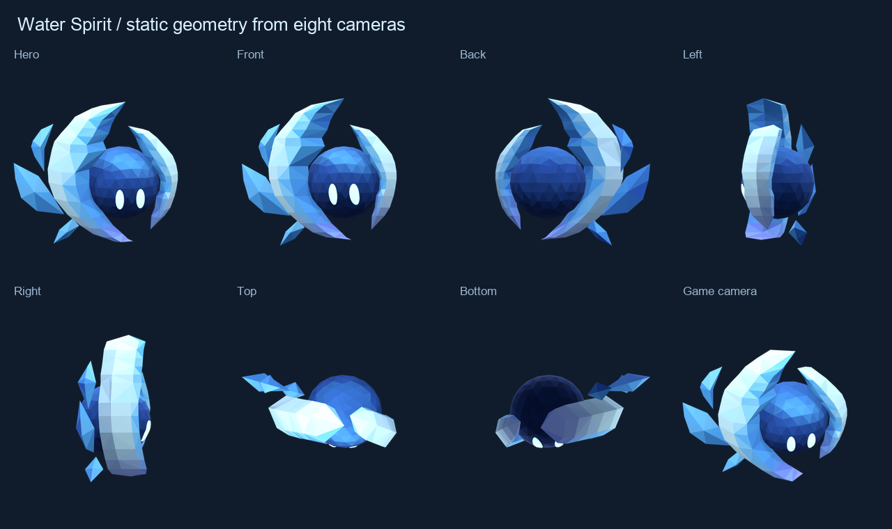
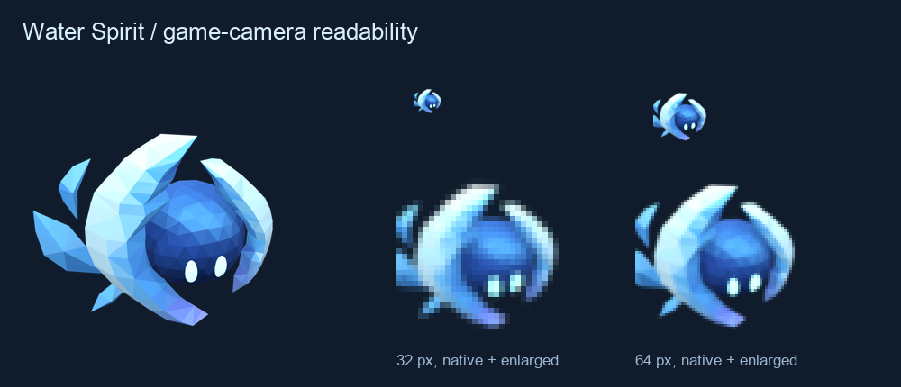

# Water Spirit, crescent study

A static model of the supplied Water Spirit sheet. The dark faceted core,
tall cyan eyes, large left crescent, smaller right crescent, soft head highlight and
three floating fins carry its silhouette. This study lives beside the
existing Water Spirit so the new direction can be reviewed independently.



## Reference decisions

`reference/sheet.png` is the original attachment. `sheet.py` crops every
view, samples the five swatches and saves traced front landmarks in
`sheet.json`. The front and isometric images control the outline, exposed
face, part arrangement and colors. The labelled side views are turned
renderings. Their apparent scale and part overlap vary, so they help
interpret volume rather than establish exact orthographic measurements.

The main and right shells are closed curved blades with a front and rear
keel. Static review clarified that the pale sweep over the head looked too
solid as a separate cap. It now blends through the core's existing facet
colors, with no raised plate or seam. This visual correction takes priority
over treating the sheet's note about three shell pieces literally. The rear
and shell thickness remain an interpretation; the static viewer exposes
that choice from every direction.

No dimension is supplied. Overall mesh height is provisionally 0.60 m,
comparable to the compact existing Water Spirit. All pixel landmarks use
one uniform scale. The sphere and blade sections contain depth; the asset
contains no image planes or reference textures.

The source faces native +Y with +Z up. The supplied front corresponds to
a camera turned 16 degrees from that direction. `export.py` temporarily
turns the meshes 180 degrees about native Z before Blender's glTF axis
conversion, giving the GLB +Y up and +Z forward. The editable source stays
in meters, with a ground reference at world origin.

## Static review



The front silhouette overlap is 90.6%, with fixed traced coordinates and
one pixel scale. The overlay includes the core, shells and fins. It measures
the mask, not color accuracy, depth or consistency across the generated
views. Yellow is reference only; red is model only. This is a useful outline
check, not a claim that every supplied view can describe the same solid.





The 32 and 64 px samples use a camera 30 degrees above the floor. The paired
eyes, dark core and opposing crescents remain visible at that scale.
The HTML inspector loads the actual GLB and provides nine camera presets,
orbit and zoom, wireframe, and a 32 px height setting. Browser review covers
desktop and a 390 x 844 viewport with a synthetic touch drag. This is browser
viewport evidence, not physical-phone performance evidence.

## Files and verification

- `water-crescent.blend` is the editable static source, with eight mesh
  objects and individual pivots. No skeleton or keyframes.
- `water-crescent.glb` has 1,798 triangles, two materials, eight primitives,
  vertex colors, cyan eye emission and no textures. Its native-facing
  dimensions are approximately 0.629 x 0.304 x 0.600 m.
- `export.json` records bounds, pivots, triangle counts and the file hash.
- `verification.json` audits closed manifold meshes, outward normals,
  triangulation, degenerate faces, flat shading, export contents and a
  Blender round trip. `reference-review.json` ties the overlay to the GLB hash.
- `browser-review.json` records the exported asset loaded in the inspector.

The eye surfaces have extra triangles to follow the faceted core.
All parts share one vertex-color material except the emissive eyes. Separate
meshes still mean eight draw calls in this standalone inspector.

Typecheck, lint and all 79 test files pass, with 665 tests passed and one
skipped. The production build passes. Gameplay content and the shipped Water
Spirit are unchanged. Animation and runtime registration follow static review.

## Rebuild

From the repository root, with Blender 4.5 LTS and `uv`:

```sh
uv run --with pillow art/spirits/water-crescent/sheet.py
/Applications/Blender.app/Contents/MacOS/Blender --background --python-exit-code 1 --python art/spirits/water-crescent/build.py
/Applications/Blender.app/Contents/MacOS/Blender --background --python-exit-code 1 --python art/spirits/water-crescent/export.py
/Applications/Blender.app/Contents/MacOS/Blender --background --python-exit-code 1 --python art/spirits/water-crescent/verify.py
/Applications/Blender.app/Contents/MacOS/Blender --background --python-exit-code 1 --python art/spirits/water-crescent/render.py
uv run --with pillow --with numpy art/spirits/water-crescent/review.py
pnpm dev --host --port 5219
```

Open `/art/spirits/water-crescent/` on the server's network address.
