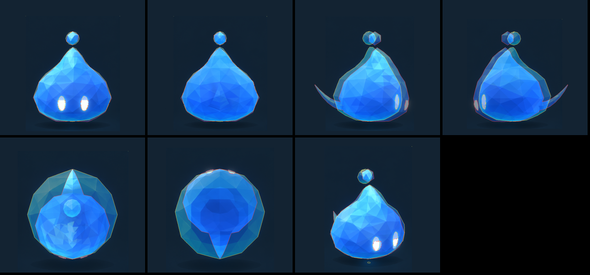
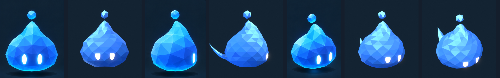

# Water spirit

The water character's spirit, as the game shows it: a faceted low-poly
droplet with two glowing eyes and a floating nub. Built only from its
orthographic model sheet (`reference/sheet.png`; the other images in
`reference/` are its views, cropped).



The model rendered from each of the sheet's cameras and laid on its view
(front, back, left, right, top, bottom, and the isometric render; sheet
outlines yellow, model red). Full size: `renders/overlay-<view>.png`.
Beside the sheet (left, front, isometric), and at the game's camera:



## From the sheet

1. `sheet.py` measures the front, back, left, and right views into
   `sheet.json`: each outline row by row, the nub, the eyes.
2. `build.py` lofts the body through those outlines: each ring takes its
   left and right extents from the front and back views and its front and
   back from the left and right views (each pair averaged), so the bulb,
   the uneven taper, and the back curving in toward the nub are the sheet's
   own. The nub floats where the views put it.
3. The eyes are thin glowing ellipses laid on the surface like stickers:
   dense discs whose every point is snapped onto the body, 2 mm above it,
   along the eye's outward direction, where and as big as the front view
   draws them. They bend with the facets, so they read as drawn on from
   every side, and each is its own object (`Eye.L`, `Eye.R` in the GLB,
   origin at the eye's center): blinking is scaling it, looking around is
   moving it.
4. `tools/sweep_score.py` finds the isometric render's camera (35° round, 10° up)
   by rendering many and scoring each against it.
5. `tools/overlay.py` lays each render on the sheet's view and scores the
   overlap: front 96%, back 97%, left and right 96%, isometric 93%, top and
   bottom 87–88% (the sheet's glow widens those).

| The sheet | The model |
| --- | --- |
| About 0.6 m tall with its nub | Body 0.5 m, hovering 6 cm, nub on top |
| Front, back, left, right outlines | Lofted through them (12 rings of 12 facets, each ring turned half a step) |
| Bottom: a concave underside | The underside's middle 4% of its height above its rim |
| Eyes: white glow | Ellipses laid on the surface, emissive white, their own objects (to blink and move) |
| Base #2E7BFF, mid #4486FF, light #8EEBFF, eye #FFFFFF | Each facet one flat color (vertex colors), deep low and away from the light, light high and toward it, glowing softly in its own color |
| Low-poly | 308 triangles for body and nub, 432 for the two eye discs (dense, to follow the facets); a 55 KB GLB |

## Animation

`animate.py` keys its two loops on its objects (no skeleton), exported with
it, and adds every spirit's combat clips (`../tools/moves.py`: a combo's
blows, the charged move, the dash, a hit taken, the special, the ultimate)
in the Tidecaller's `STYLE` (and a `Tail`, not on the sheet: a fin curling up
from low on its back, wagging in the idle and streaming in the run, so from
behind it says which way she faces; the nub rests a little behind the tip
for the same reason): she throws, winding far round and snapping
through. Her eyes have her own shape (`EYE_SHAPE` in `build.py`: wide and
half-lidded, calm). The loops:

- **Idle** (2 s loop): a gentle bob, squashing a little at the bottom; the
  nub floats out of step with it, circling and spinning slowly; one blink
  (the eyes squash shut and open).
- **Run** (one hop every 0.53 s; the game plays one per 120 units covered):
  a small hop squashing as it lands, leaning into the run, the nub trailing
  behind and lagging the hop.

The trail of drops is the game's (`ShedSpiritDrops` in
`src/presentation/effects.ts`, drawn by `drop-trail.ts`, set by its look's
`drops`): drops in the 3D scene, so its body hides the ones behind it,
thrown back from its back while it moves, falling to the floor, about half
leaving a ripple that spreads and fades there.

## Rebuild

From the repository root, with Blender 4.5 LTS and `uv` (the shared tools
are in `../tools/`, see `docs/spirits.md`):

```sh
uv run --with pillow --with numpy art/spirits/water/sheet.py                       # sheet.json (once per sheet)
blender --background --python-exit-code 1 --python art/spirits/water/build.py     # water-spirit.blend
SWEEP=/tmp/sweep blender --background --python art/spirits/tools/render.py -- water   # isometric camera candidates
uv run --with pillow --with numpy art/spirits/tools/sweep_score.py water /tmp/sweep  # its camera, into sheet.json
blender --background --python-exit-code 1 --python art/spirits/tools/render.py -- water  # renders/
uv run --with pillow --with numpy art/spirits/tools/overlay.py water                 # renders on the sheet, scored
uv run --with pillow --with numpy art/spirits/tools/compare.py water                 # renders/compare.png
blender --background --python-exit-code 1 --python art/spirits/water/export.py     # water-spirit.glb with its clips, src/presentation/assets/water-spirit.ts
```
