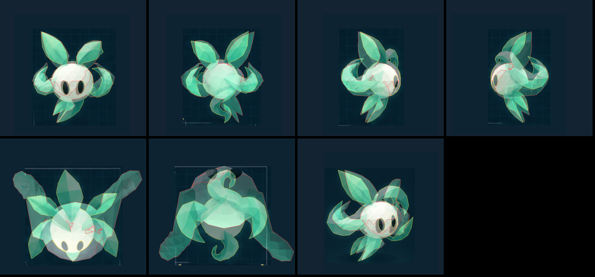
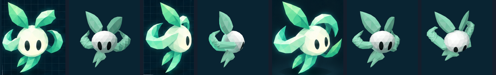

# Wind spirit

The wind character's spirit: a faceted, pale mint ball with dark eyes, two
crystal leaves on top, a flat crescent blade on each side sweeping back and
curling up to a sharp point, and two leaves hanging under it. Built only from its
production model sheet (`reference/sheet.png`; the other images in
`reference/` are its views, cropped). In the game it is the wind
character's (the Swordsman's) spirit.



The model rendered from each of the sheet's cameras and laid on its view
(front, back, left, right, top, bottom, and the isometric render; sheet
outlines yellow, model red). Beside the sheet, and at the game's camera:



## From the sheet

1. `sheet.py` measures the front and left views into `sheet.json`: the
   body, an ellipse fitted to its near-white outline where it meets the
   background (the leaves and horns cover the rest); each leaf's base,
   tip, and widths from base to tip; each horn's middle line and its width
   along it; and the eyes (the holes in the body).
2. `build.py` makes the body a faceted ball through those ellipses (its
   width from the front view, its depth from the left view), and each part
   its own object, its origin at its base, to sway:
   - the leaves are crystal blades from base to tip, across and height
     from the front view, front to back from the left view, their blades
     turned between the two so each view sees its own width; the leaves
     under it bend as the views draw their middle lines (where one view
     loses a bent leaf, the other's widths are used);
   - the horns follow their middle lines (across from the front view, depth
     from the left view's, height halfway between theirs), rooted in the
     body's sides (both views lose the root where it crosses the body) and
     swept from there in one curve; flat crescent blades as wide as both
     views draw them, turned between the views and tipped a little face up
     (toward the game's camera), drawn to a sharp point;
   - the dark eyes are laid on the surface (`Eye.L`, `Eye.R`, to blink),
     one size, mirrored about the body's middle.
3. Colors are the swatches, one per facet: the body pale mint (nearly
   white only toward the light, pale aqua round it, mint toward its edges
   and lower facets); the leaves mint to teal.
4. `tools/overlay.py` scores the overlap: front 74%, back 62%, left 64%,
   right 61%, the isometric render 56%, top 46%, bottom 47%.

**Where the sheet disagrees with itself.** The model follows the front and
left views. The back view draws an S-shaped tail wrapping round the body
where the front and side views draw two leaves; the right view is not the
left's mirror image (its horn comes over the top of the head); the left
view shows a curl above the head that no other view has; the top view
draws five leaves round the body. Its measurements label the body 0.32 m
tall; its drawings measure about 0.24 m.

## In the game

- **Clips** (`animate.py`, keyed on its objects, exported with it): an idle
  that bobs and tilts on a breeze while the top leaves flutter, the horns
  sway, and the leaves under it swing, with a blink; a run that hops,
  squashes on landing, and leans in, its leaves and horns swept back.
  Its combat clips (a combo's blows, the charged move, the dash, a hit
  taken, the special, the ultimate) are every spirit's (`../tools/moves.py`),
  in its character's `STYLE`: the Swordsman cuts, a long lunge rolling with the blade, her big blows a whole turn. Her eyes have her own shape
  (`EYE_SHAPE` in `build.py`): tall and narrow, a slight slant.
- **Glow** (`windGlow` in `src/presentation/models.ts`): teal edges and a
  teal halo, kept low (its palette is pale); its eyes stay dark.
- **Wisps** while it moves (its look's `drops` with `kind: "wisp"`): mint
  and white motes curling away behind it as they fade.
- Scaled by its whole height, top leaves included (they grow from it), so
  it stands as tall as the other spirits.

## Rebuild

From the repository root, with Blender 4.5 LTS and `uv` (the shared tools
are in `../tools/`, see `docs/spirits.md`):

```sh
uv run --with pillow --with numpy art/spirits/wind/sheet.py                       # sheet.json (once per sheet; drops the isometric camera)
blender --background --python-exit-code 1 --python art/spirits/wind/build.py     # wind-spirit.blend
SWEEP=/tmp/sweep blender --background --python art/spirits/tools/render.py -- wind   # isometric camera candidates
uv run --with pillow --with numpy art/spirits/tools/sweep_score.py wind /tmp/sweep  # its camera, into sheet.json
blender --background --python-exit-code 1 --python art/spirits/tools/render.py -- wind  # renders/
uv run --with pillow --with numpy art/spirits/tools/overlay.py wind                 # renders on the sheet, scored
uv run --with pillow --with numpy art/spirits/tools/compare.py wind                 # renders/compare.png
blender --background --python-exit-code 1 --python art/spirits/wind/export.py     # wind-spirit.glb with its clips, src/presentation/assets/wind-spirit.ts
```
