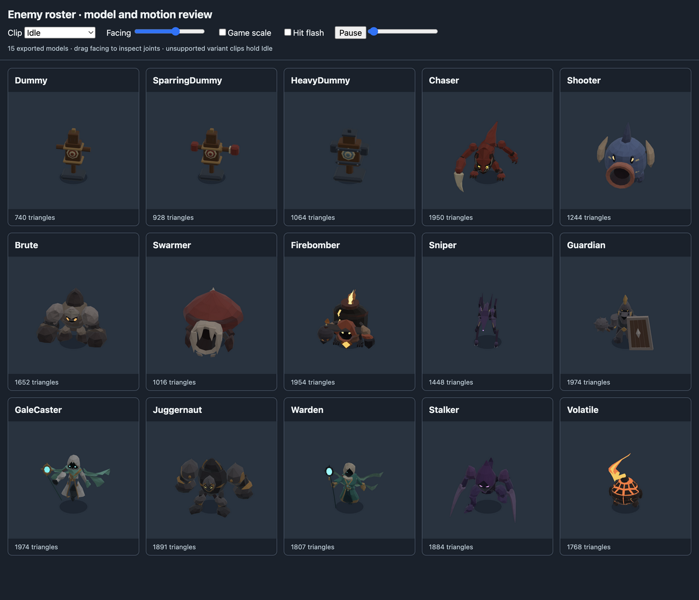

# Enemy roster polish

Reconciled `enemy-models-inspect` onto main at `cba6579`, including the newer
Warden, Stalker, Volatile, Gale Caster and Juggernaut. Main's contact-preserving
blending and Warden ward pose remain in use. The roster references guided colour,
silhouette and character; gameplay-scale readability guided the exaggeration.

Every crowd model now has a quiet facet rim, visible hit/windup light, staggered
idle phases and movement turning. Attack aim and shield direction stay exact.
Eyes and authored fire/gem regions emit through one vertex mask. The fifteen
models still use one skinned mesh, one material and one body draw call per model
kind. All fit below 2,000 triangles and at most twelve bones.

| Enemy | Finished changes | Triangles / bones |
|---|---|---|
| Training Dummy | Wooden timbers, circular bullseye and top peg; fixed base joined to bending post | 740 / 3 |
| Sparring Dummy | Red padded guards and an articulated striking bar; joined shoulder and a readable windup/sweep | 928 / 4 |
| Heavy Dummy | Broader timber torso and post, iron bands and shoulder weights, larger base and blue bullseye | 1,064 / 3 |
| Chaser | Thicker limbs, larger claw and eyes; connected hips, shoulders, neck and ankles; whole-body coil | 1,950 / 12 |
| Shooter | Slanted eyes, ivory studs, connected feet/fins; larger breathing, recoil and muzzle windup | 1,244 / 8 |
| Brute | Rougher larger fists and shoulders, slanted eyes; joined hips/shoulders/neck; raised slam and separate knee-lift stomp | 1,652 / 7 |
| Swarmer | Lower rounded shell with attached crest, larger gameplay size; joined legs; rearing jaw windup | 1,016 / 7 |
| Firebomber (`charger`) | Warm body and dark bomb pack, luminous belly core/cracks, joined throwing arm and feet; corrected floor clearance | 1,954 / 9 |
| Sniper | Thicker shins/ankles/feet, lighter head/shoulders, larger eyes and luminous muzzle; extra release recoil and joined articulated legs | 1,448 / 11 |
| Guardian | Dark visor and clearer plate values, joined shoulders/hips/neck; shield-side connection follows independent blocking aim | 1,974 / 7 |
| Warden | Darker face, larger luminous staff gem; connected neck, sleeves and staff grip; ward pose stays distinct from bolt cast | 1,807 / 10 |
| Stalker | Separate hood, torso, shoulder and blade values; neck/shoulder joins plus existing leg bridges; existing blink/slash variants retained | 1,884 / 7 |
| Volatile | Wider stone gaps reveal luminous lava; luminous mouth/eyes/flame core; existing connected feet and flame lag retained | 1,768 / 5 |
| Gale Caster | Clear dark face and luminous staff/eyes, joined hood/sleeves; visible floor gap; existing ribbon lag and timed float cycle retained | 1,974 / 9 |
| Juggernaut | Lower back frame exposes helmet, stronger brow/face contrast; connected neck/shoulders/hips; tiny knuckle caps traded for joints | 1,891 / 7 |

Brute rests with lowered wide fists; raised fists are its slam warning. The
Swarmer's presentation size increases from 1.5 to 1.8 times its radius. Its
simulation radius stays 10. The three training roles each have their own model
at their existing sizes. No enemy stats, attacks, content ids or progression changed.

The first pass left five inherited Idle clips too subtle to read. Sniper now
scans with its barrel and claws over planted articulated legs; Stalker breathes
and scans with opposing blade drift; Guardian watches over a settling mace;
Firebomber heaves its pack with a hanging bomb hand and trailing flame; and
Juggernaut breathes through its shoulders with hanging fist sway. These loops
remain smaller than their attack coils and retain independent foot plants.

The editable final assets and reproducible recipe are described in
[the finishing workflow](../art/enemies/polish-tools/README.md). Static reference
renders describe the base source; use the finishing viewer and final exports to
judge this version.

## Validation

Fresh Blender imports reproduce every exported keyframe, including loop closure.
All attack phase boundary vertices agree within 0.00001 m, including ranged
attacks which skip Active. Living poses stay within 1 mm of the floor. GLBs load
through Three.js, retain normalized skin weights and valid luminous masks, and
GPU atlas samples match Three.js skinning.

A regression check projects these five Idle clips from the game camera at a
40 px model height in two facings. It requires visible motion across a broad
part of each figure, rather than accepting movement from one decorative tip.

Roster coverage checks all fifteen content kinds against the model mappings:
twelve combat enemies and three dummy roles. Every kind has a batched animated
model, and the three dummies have distinct exported assets. There are no capsule
enemy placeholders. Training Ground, Enemy Practice, waves, elites and tuning
spawns all use these same mappings.

The network-address browser review covers desktop 1280×800, phone landscape
844×390 and portrait 390×844, all combat enemies through windup/contact/recovery, native mouse taps
on the touch-enabled controls, and a synthetic touch-stick drag through the
real input binding. Synthetic capture was bypassed only in the review page;
the player moved and returned to neutral input without errors. This is desktop
browser evidence, not physical-phone performance testing.

The touch HUD now refreshes its resting layout immediately after a viewport
rotation. An active gesture keeps its original layout until release.

The Training Ground review shows all three target models at 1280×800 and
844×390. A synthetic touch-stick drag approaches Sparring Dummy and exercises
its windup, active sweep and recovery through the real simulation and input
binding. The gesture returns to neutral and its temporary capture bypass is
restored. Both target exports pass fresh Blender round-trips and contact checks.

[Revised Idle loops in motion](../art/enemies/polish-tools/evidence/roster-idle.mp4)
